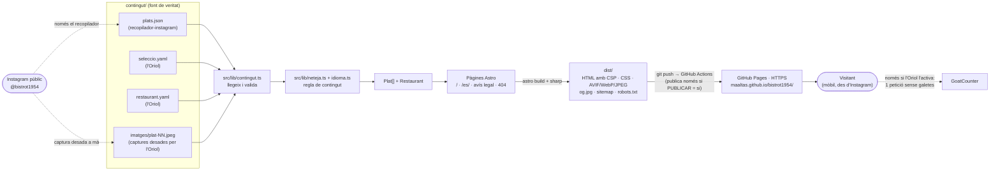

# Arquitectura · Web del Bistrot 1954

Versió 2 · 2026-11-10 · autor: arquitecte-backend

> Aquest document mana en tot el que és tècnic: framework, model de dades, rutes, pipeline de contingut, imatges, SEO tècnic, desplegament i seguretat. L'aspecte i la distribució els decideix `docs/disseny-frontend.md` dins d'aquest marc. Si cal canviar alguna cosa d'aquí, s'apunta a `docs/dubtes.md`.
>
> **Canvis de la versió 2.** Incorpora les respostes de l'Oriol a D-01..D-12: web bilingüe confirmada, telèfon i horari, publicació a GitHub Pages, avís legal de demostració, estadístiques sense galetes, fotos definitives, fitxa de Google Maps i text de presentació. També resol el conflicte D-11 amb `docs/disseny-frontend.md`: retall de les fotos, `srcset`, `og.jpg` i avisos del build. Cloudflare deixa de formar part del projecte.
>
> **Actualització (2026-11-10, D-13):** no hi ha domini propi. La web es publica a l'adreça per defecte de GitHub Pages, `https://maaltas.github.io/bistrot1954/` (usuari `Maaltas`, repositori `bistrot1954`), i Astro treballa amb `base: '/bistrot1954'`. En local es prova a `http://localhost:4321/bistrot1954/`. **Totes les rutes d'aquest document i de `docs/disseny-frontend.md` (`/`, `/es/`, `/avis-legal/`…) són relatives a aquesta base**: `/es/` vol dir `/bistrot1954/es/`.
>
> **Actualització (2026-11-11, regla de l'Oriol):** la història no repeteix el nom del plat quan l'encapçala (pas N8, §3.3; fixture §3.4.3 actualitzada; criteris §3.5 i C-11). Els plats ja no enllacen al seu post d'Instagram (§4.5, C-07); `urlPost` es conserva a les dades.
>
> **Actualització (2026-11-11, D-19):** el disseny vigent és `docs/disseny-frontend.md` v2, "La carta" (P3). Canvis d'arquitectura: finestra de foto rodona i `sizes` nou (§6.3, R-09); tipografies EB Garamond (normal i cursiva) i Jost 500, amb un límit de 150 KB (§2.4, §6.7, R-06b); `genera-og.mjs` amb els paquets nous (§2.1, §6.6); i cap maqueta `/propostes/` a la web final (§5.1, T-08). El model de dades, les rutes i la regla de contingut no canvien.

## 0. Decisions clau

| Tema | Decisió |
|---|---|
| Tipus de web | Estàtica, generada en temps de build. Sense servidor, sense base de dades i sense JavaScript propi obligatori. |
| Framework | Astro 7, com a mínim 7.4.10 (sortida `static`), TypeScript estricte, CSS propi amb custom properties. La versió 6 té vulnerabilitats crítiques sense correcció (D-16, §2.1). |
| Fonts de contingut | `contingut/plats.json` (recopilador) + `contingut/seleccio.yaml` (Oriol) + `contingut/restaurant.yaml` (Oriol) + `contingut/imatges/`. |
| Idiomes | Català a `/` (per defecte) i castellà a `/es/` (confirmat, D-01). Cada història es mostra en l'idioma original del caption; **mai es tradueix**. |
| Regla de contingut | Neteja automàtica, determinista i testejada (§3.3). S'aplica també al text de presentació de l'Oriol (§4.3.2). Cap text escrit a mà ni generat amb IA. |
| Imatges | Les 8 captures de ~450×600 px són definitives (D-09). sharp genera AVIF + WebP + JPEG a 360 px i a l'ample real de la font. La finestra rodona (disseny v2 "La carta") es fa amb CSS, sense retall en el build (§6.3). La primera foto és prioritària i la resta es carreguen en diferit. |
| Imatge per compartir | Sempre `public/og.jpg`, tipogràfica, de 1200×630 px (§6.6). Mai una foto de plat. |
| Contacte | "Trucar" (`tel:+34936273536`) és l'única crida de reserva. "Com arribar" porta a la fitxa de Google Maps, i també hi ha l'enllaç a Instagram (§8). |
| Hosting | GitHub Pages, publicat amb GitHub Actions en fer `git push` a `main`, des del repositori públic `Maaltas/bistrot1954`. Adreça: `https://maaltas.github.io/bistrot1954/`, amb `base: '/bistrot1954'` i sense domini propi (D-13). **Publicada** el 2026-11-11 amb el vistiplau de l'Oriol. Cada `push` a `main` el fa el coordinador quan l'Oriol l'aprova (§9.4, D-13). |
| Cost | 0 €: repositori públic i sense domini. Un domini propi seria una opció futura (§9.3). |
| Privacitat | Cap galeta ni res desat al navegador. L'única petició a tercers permesa és el comptador de GoatCounter, sense galetes, quan l'Oriol l'activi (§10.6, D-14). |

---

## 1. Resum i diagrama

La web és un conjunt de fitxers estàtics (HTML, CSS, imatges optimitzades) que Astro genera a partir de la carpeta `contingut/`. El contingut entra per dues vies separades:

- **Automàtica:** l'agent `recopilador-instagram` escriu `contingut/plats.json` (caption literal i sencer) i, quan pot, la foto a `contingut/imatges/`. Cap altra peça del sistema toca Instagram.
- **Manual (l'Oriol):** `contingut/seleccio.yaml` diu quins posts són plats, en quin ordre surten i quin nom tenen. `contingut/restaurant.yaml` conté les dades confirmades del restaurant (incloent-hi el text de presentació) i les dades de demostració de l'avís legal. Les fotos que el recopilador no pugui baixar (avui, totes) l'Oriol les desa a mà a `contingut/imatges/`.

En el build, `src/lib/contingut.ts` llegeix i valida aquests fitxers, `src/lib/neteja.ts` i `src/lib/idioma.ts` apliquen la regla de contingut i les pàgines Astro generen `dist/`. Cada `git push` a `main` fa que GitHub Actions comprovi i construeixi la web. Quan la publicació estigui activada, també la publica a GitHub Pages, amb HTTPS, a `https://maaltas.github.io/bistrot1954/`.



---

## 2. Stack escollit

### 2.1 Peces

| Peça | Versió | Per què |
|---|---|---|
| Node.js | ≥ 22.23.4 (local: 26.13 LTS) | Requisit d'Astro 7.4.10. `.node-version` (26.13.0) fixa la versió local; el workflow de GitHub Actions fa servir Node 26 (§9.2). |
| Astro | `^7.4.10` (`output: 'static'`) | Genera HTML estàtic amb zero JS per defecte; porta `<Picture>` amb sharp (AVIF/WebP i `srcset`), rutes i18n, API de tipografies que les **descarrega i autoallotja** en build, API de CSP amb hashes, i integració de sitemap. És el que necessitem sense afegir res més. |
| TypeScript | estricte (`astro/tsconfigs/strict`) | Errors de model de dades detectats abans de publicar. |
| sharp | la que porti Astro | Servei d'imatges per defecte d'Astro. Té binaris precompilats per a Windows x64; no cal compilar res. |
| `@astrojs/sitemap` | `^3.7` (provada amb Astro 7) | Sitemap amb alternates `hreflang`. |
| `yaml` | ^2 | Llegir `seleccio.yaml` i `restaurant.yaml` (YAML permet comentaris, més amable per editar a mà que JSON). |
| `astro/zod` | Zod 4 (inclòs a Astro) | Validació dels tres fitxers de contingut amb missatges clars. |
| `@astrojs/check` + `typescript` | dev | `astro check` abans de cada build. |
| Vitest | dev, `^5` | Tests unitaris de la neteja i de la detecció d'idioma. Ha de ser una versió que accepti Vite 8 (el d'Astro 7). |
| `@playwright/test`, `@axe-core/playwright`, `html-validate` | dev | Infraestructura per al QA (el programador les instal·la; el QA només escriu tests a `tests/qa/`). Lighthouse s'executa amb `npx`. |
| `@fontsource/eb-garamond`, `@fontsource/jost` | dev | Només per generar `public/og.jpg` en local (§6.6). La web fa servir les tipografies que descarrega l'API d'Astro, no aquests paquets. Substitueixen els d'Alegreya (D-19). |
| CSS | propi | Fitxers CSS i estils d'Astro amb custom properties que reprodueixen els tokens de `docs/disseny-frontend.md`. Sense Tailwind ni biblioteques de components. |
| Framework de UI | cap | No hi ha React, Vue ni similars. Si el disseny necessita alguna interacció, JS vanilla dins del pressupost de §11. |

**Per què Astro 7 i no 6 (D-16, 2026-11-10).** Totes les versions d'Astro fins a la 7.3.1 tenen una vulnerabilitat crítica: diversos avisos GHSA d'XSS (`renderHTMLElement`, `transition:*`, View Transitions, JSX/MDX), d'execució remota en optimitzar AVIF i de *bypass* del `base`. Només està corregida a la 7.4.10, i la branca 6 no rebrà més correccions.

La web no fa servir les funcions de risc més clar: és estàtica, sense *view transitions* ni MDX, i les imatges són pròpies i es processen en build. Tot i així, l'avís que afecta el `base` toca una peça que ara sí que fem servir. A més, acceptar una crítica deixaria P-07 sense sentit i ens deixaria en una branca sense manteniment.

La migració té poc impacte, segons la guia oficial de pas a la v7:
- **Vite 8.** `?raw` i `import.meta.glob` no canvien. Cal Vitest 5.
- **Compilador en Rust.** És més estricte: les etiquetes sense tancar i les imbricacions invàlides (un `<div>` dins d'un `<p>`) donen error. És una millora, i s'han de corregir si n'hi ha.
- **`compressHTML`.** El valor per defecte passa a `'jsx'`, que pot treure espais entre elements en línia. Es fixa `compressHTML: true` per mantenir el comportament d'Astro 6 (§2.4).
- **Sense canvis.** La guia no indica canvis a les tipografies, la CSP, `astro:assets`, `base`, i18n ni sitemap. Es comprova amb els tests i amb els criteris de §11.
- **Sense efecte.** No fem servir res del que la v7 elimina o mou: `@astrojs/db`, `astro:transitions`, `getContainerRenderer`, plugins de remark/rehype ni `src/fetch.ts`.

### 2.2 Alternatives descartades

| Alternativa | Per què no |
|---|---|
| Eleventy 3 | Bona i lleugera, però caldria muntar a mà el pipeline d'imatges, les rutes per idioma, la validació i la CSP. Astro ho porta integrat amb el mateix cost. |
| Hugo | Binari no instal·lat a l'entorn, plantilles Go més difícils de mantenir per a l'equip d'agents i tests en un altre ecosistema. |
| HTML a mà + script Python | Python només amb ruta completa a l'entorn, sense pipeline d'imatges ni validació; afegir un plat implicaria tocar HTML. |
| WordPress o un altre CMS amb servidor | Servidor, base de dades, actualitzacions i superfície d'atac desproporcionats per a 8-30 plats. |
| Wix / Squarespace | De pagament, porten cookies i trackers, i no permeten aplicar la regla de contingut de manera automàtica i verificable. |
| Next.js / Nuxt | Pensats per a aplicacions; més JS al client i més complexitat sense cap benefici aquí. |
| Widgets d'Instagram incrustats (Behold, Elfsight, l'*embed* oficial) | Carreguen JS i cookies de tercers, pesen molt al mòbil i no deixen aplicar la regla de contingut. |
| Hosting: Cloudflare Workers o Pages | Era la recomanació de la versió 1 (capçaleres pròpies i memòria cau configurable). Queda descartat per decisió de l'Oriol (D-04), que vol tenir-ho tot a GitHub. Si algun dia calen capçaleres HTTP, Cloudflare es pot posar davant de GitHub Pages com a proxy gratuït sense tocar el build (§9.6). |
| Hosting: Netlify | El pla gratuït funciona amb crèdits mensuals que limiten desplegaments i transferència. |
| Hosting: Vercel Hobby | Les condicions del pla gratuït n'excloen l'ús comercial; un restaurant és un ús comercial. |
| GitHub Pages publicat des d'una branca (`gh-pages`) | Obligaria a versionar `dist/` o a fer servir una acció de tercers. El flux oficial d'Astro amb Actions construeix i publica sense deixar fitxers generats al repositori (§9.2). |
| Estadístiques: Cloudflare Web Analytics, Umami, Plausible, Google Analytics | Vegeu §10.6. |

### 2.3 Compatibilitat amb l'entorn (Windows 11)

- **Node al PATH.** Si la terminal no troba `node`: a Git Bash `export PATH="/c/Program Files/nodejs:$PATH"`; a PowerShell `$env:Path = "C:\Program Files\nodejs;" + $env:Path`. El README ho ha de dir.
- **Scripts portables.** Els scripts de `package.json` s'executen amb `cmd.exe` a Windows: res de `rm -rf`, `VAR=valor ordre`, globs de bash ni `&` en segon pla. Qualsevol script auxiliar s'escriu en Node (`scripts/*.mjs`), mai en bash ni Python.
- **Salts de línia.** `.gitattributes` amb `* text=auto eol=lf`. La neteja normalitza `\r\n` igualment (§3.3, N1).
- **Noms de fitxer.** Imatges en minúscules (`plat-09.jpeg`). El sistema de fitxers de Windows no distingeix majúscules, però el build de GitHub Actions (Linux) sí.
- **Variables d'entorn a PowerShell.** Per simular un build de publicació (§2.4): `$env:CI="true"; npm run build; Remove-Item Env:CI`. Sense les variables de GitHub, fa servir `site` i `base` per defecte, que són els de producció.
- **QA en local.** `npx playwright install chromium` una vegada. Lighthouse fa servir el Chrome instal·lat; si no el troba, s'exporta `CHROME_PATH` amb la ruta del Chrome o del Chromium de Playwright.
- No cal Docker ni Python.

### 2.4 Configuració d'Astro (especificació)

`astro.config.mjs` ha de definir, i res més que no calgui:

- `output: 'static'`, `trailingSlash: 'ignore'`, `build.format: 'directory'`.
- **Build local i build de publicació.** Un build és *de publicació* quan la variable d'entorn `CI` està definida (GitHub Actions la defineix sempre). Tota la resta (`dev`, `build` i `preview` a l'ordinador) és un *build local*. La decisió es pren en un sol lloc, `src/lib/entorn.ts`, que fan servir `astro.config.mjs` i els components.
- **`site` i `base`** es calculen a `src/lib/entorn.ts`. L'usuari de GitHub de l'Oriol és `Maaltas` (D-13), i GitHub Pages en posa el host en minúscules.

  | Cas | `site` | `base` |
  |---|---|---|
  | Per defecte: build local, o build de publicació sense les variables de GitHub | `https://maaltas.github.io` (constant `SITE_PER_DEFECTE`) | `/bistrot1954` (constant `BASE_PER_DEFECTE`) |
  | Build de publicació a GitHub Actions, amb `web_url` = `null` (avui) | `https://<propietari>.github.io`. `<propietari>` és `GITHUB_REPOSITORY_OWNER`, passat a minúscules | `/<repositori>`: la part de `GITHUB_REPOSITORY` (`propietari/repositori`) que va darrere de la barra |
  | Qualsevol build amb `web_url` definit (domini propi, opció futura, §9.3) | `web_url` | `/` |

  - Avui els tres camins donen el mateix: `https://maaltas.github.io` + `/bistrot1954`.
  - **Avís de coherència.** Si en un build de publicació els valors derivats no coincideixen amb els per defecte (per exemple, si el repositori es reanomena), el build avisa `[entorn] la URL derivada (…) no coincideix amb la per defecte (…)` i fa servir la derivada.
- **`<web>`** és, en tot aquest document, la URL pública de la portada amb barra final (`site` + `base` + `/`): **`https://maaltas.github.io/bistrot1954/`**. També és el que surt als canonicals, `hreflang`, OG, sitemap i JSON-LD del build local, que així és idèntic al publicat.
- **URL per provar en local:** `astro dev` i `astro preview` serveixen la web a **`http://localhost:4321/bistrot1954/`** (i `http://localhost:4321/bistrot1954/es/`). `http://localhost:4321/` no és la web.
- **Enllaços amb `base`.** Tots els enllaços interns i totes les referències a fitxers de `public/` (`og.jpg`, icones, `js/count.js`) es construeixen amb la funció `ruta()` d'`entorn.ts`, que afegeix `base` i deixa una sola barra. Per exemple, `ruta('/es/')` → `/bistrot1954/es/` i `ruta('/og.jpg')` → `/bistrot1954/og.jpg`.
  - **Mai** s'escriu un `href` o un `src` literal que comenci per `/`.
  - Els fitxers que genera Astro (`/_astro/…`, tipografies, imatges) ja porten `base` sols.
  - Els enllaços de canvi d'idioma també passen per `ruta()` (o per `getRelativeLocaleUrl()` d'`astro:i18n`, que té en compte `base`).
- `i18n`: `locales: ['ca', 'es']`, `defaultLocale: 'ca'`, `routing: { prefixDefaultLocale: false }`.
- Integració `@astrojs/sitemap` (§7.4).
- `security.csp` activat (§10.3). L'excepció de les estadístiques només s'hi afegeix en un build de publicació (§10.6).
- `fonts`: **només** les dues famílies del disseny vigent (`docs/disseny-frontend.md` v2, §5.2): EB Garamond (400 `normal` i 400 `italic`) i Jost (500 `normal`). Proveïdor Google i `subsets: ['latin']` (§6.7). Cap altra família, tampoc les de les maquetes de la branca `propostes-disseny` (D-19).
- `base` segons la taula anterior, i `trailingSlash: 'ignore'`. Amb `base`, Astro continua generant els fitxers a l'arrel de `dist/` (`dist/index.html`, `dist/es/index.html`…); és GitHub Pages qui els serveix sota `/bistrot1954/`.
- `prefetch` i *view transitions* desactivats (són JS que no necessitem).
- `compressHTML: true`, explícit. És el comportament d'Astro 6: conserva un espai entre elements en línia, per exemple entre un enllaç i el text que el segueix (§2.1).
- No s'activa cap opció `experimental` que no calgui. Si Astro 7 ja té estable alguna API que l'arquitectura feia servir com a experimental (tipografies, CSP), es fa servir la forma estable.

---

## 3. Pipeline de contingut

### 3.1 Fitxers i lectura

| Fitxer | Qui l'escriu | Format | Qui el llegeix |
|---|---|---|---|
| `contingut/plats.json` | només `recopilador-instagram` | JSON, array de posts (§4.1) | `src/lib/contingut.ts`, `scripts/pendents.mjs`, QA |
| `contingut/imatges/plat-NN.jpeg` (o `.jpg`, `.png`, `.webp`) | l'Oriol a mà (o el recopilador, si pot) | JPEG, PNG o WebP | `src/lib/contingut.ts` (`import.meta.glob`), `scripts/pendents.mjs` |
| `contingut/seleccio.yaml` | l'Oriol (inicialment el programador, amb el contingut de §3.2) | YAML (§4.2) | `src/lib/contingut.ts`, `scripts/pendents.mjs` |
| `contingut/restaurant.yaml` | l'Oriol (inicialment el programador, amb el contingut de §4.3) | YAML (§4.3) | `src/lib/contingut.ts`, `astro.config.mjs` |
| `contingut/posts.txt` | l'Oriol (opcional) | una URL per línia | només el recopilador |

Lectura (tot en temps de build; res al navegador):

1. `src/lib/contingut.ts` és **l'únic punt d'accés** a `contingut/` des de l'aplicació. Importa els tres fitxers de text amb `?raw` (Vite els vigila en mode `dev`), els parseja (`JSON.parse`, `yaml.parse`) i els valida amb esquemes Zod.
2. Les imatges es resolen amb `import.meta.glob('/contingut/imatges/*.{jpg,jpeg,png,webp}', { eager: true })` (§6.2).
3. Uneix les tres fonts: per a cada entrada visible de `seleccio.yaml`, agafa el post de `plats.json`, li aplica la neteja (§3.3) i construeix un `Plat` (§4.4).
4. Exporta `getPlats(): Plat[]` (només visibles, en l'ordre de `seleccio.yaml`) i `getRestaurant(): Restaurant`. En mode `dev` no es fa servir memòria cau de mòdul, perquè els canvis als YAML es vegin en recarregar.

Errors i avisos. Els missatges són en català i diuen sempre el fitxer, l'`id` i què cal fer.

| Situació | Resultat |
|---|---|
| `plats.json` no és JSON vàlid o no compleix l'esquema; `id` duplicat | **Error: el build falla** |
| `seleccio.yaml` no és YAML vàlid o no compleix l'esquema; `id` que no existeix a `plats.json`; `id` repetit | **Error** |
| `nom` que no és un fragment del caption i no porta `nom_confirmat: true` (§3.2) | **Error** |
| `idiomes` amb un nombre d'elements diferent del nombre de paràgrafs nets (§3.3, I5) | **Error** |
| `restaurant.yaml` invàlid; sense `nom`, `adreca`, `instagram` o `avis_legal`; `telefon`, `horari`, `estadistiques` o `avis_legal` amb format incorrecte (§4.3) | **Error** |
| `avis_legal.demostracio: true` amb un NIF que no és de zeros o un correu que no és d'`example.com` (§4.3.3) | **Error** |
| Plat seleccionat sense imatge | Avís `[contingut] plat-NN sense imatge: es mostra sense foto` |
| Imatge de menys de 400 px d'ample (§6.1) | Avís `[contingut] plat-NN: la foto fa N px d'ample (mínim 400): es veurà ampliada` |
| Post de `plats.json` que no és a `seleccio.yaml` | Avís `[contingut] plat-NN pendent de classificar (no surt a la web)` |
| Idioma d'un paràgraf assignat per descart (§3.3, I4) | Avís |
| `presentacio` d'un idioma que queda buida després de la neteja (§4.3.2) | Avís (aquell idioma es tracta com a `null`) |
| `public/og.jpg` no existeix (§6.6) | Avís `[contingut] falta public/og.jpg: no s'emet og:image` |
| Build de publicació amb `avis_legal.demostracio: true` | Avís `[contingut] l'avís legal porta dades de demostració` |
| Build de publicació amb `site` o `base` derivats diferents dels per defecte (§2.4) | Avís `[entorn] …` |
| Fitxer a `contingut/imatges/` que no correspon a cap `id` | Avís |
| Camps desconeguts a `plats.json` | Avís (s'ignoren) |

Avui hi ha les 8 fotos de `contingut/imatges/` (`plat-01.jpeg` … `plat-08.jpeg`, d'uns 450 px d'ample). Un cop creat `public/og.jpg` (tasca F-22), un build local ha de passar **sense cap avís `[contingut]`**. Abans, l'únic avís és el d'`og.jpg`. La variant "sense imatge" ja no es pot veure amb el contingut real i es prova amb un test unitari (tasca B-12).

### 3.2 Selecció de plats: `contingut/seleccio.yaml`

El recopilador ja tria posts que semblen plats, però **qui decideix què surt a la web és l'Oriol**, i ho fa en un fitxer separat de `plats.json` perquè aquest el manté una màquina i no s'ha d'editar a mà.

Regles:

- Només surten a la web els posts que hi són i no tenen `amagat: true`.
- L'ordre de la llista és l'ordre de la web.
- `nom` és obligatori en català i opcional en castellà (si falta, la pàgina en castellà mostra el nom català amb `lang="ca"`).
- **El nom ha de ser un fragment literal del caption.** Es comprova en el build, sense distingir majúscules i minúscules, i després de treure emojis i normalitzar espais i apòstrofs (`’` → `'`). Només es permet posar en majúscula la primera lletra. Si un caption no anomena el plat, l'Oriol pot escriure'n el nom i afegir `nom_confirmat: true`. **Cap agent pot posar `nom_confirmat: true`**: és la manera que té l'Oriol de dir "aquesta dada la confirmo jo". El QA ha de llistar al seu informe els plats que el portin.
- `idiomes` és opcional i només serveix per corregir la detecció automàtica (§3.3, I5).

Contingut inicial. El programador el crea tal qual. Els noms són fragments literals de cada caption i l'Oriol els ha confirmat (D-07); cap porta `nom_confirmat`.

```yaml
# Quins posts de contingut/plats.json surten a la web, en quin ordre i amb quin nom.
# - L'ordre d'aquesta llista és l'ordre de la web.
# - nom: copia'l tal qual del caption (només pots posar la primera lletra en majúscula).
# - Per amagar un plat sense esborrar-lo, afegeix-hi:  amagat: true
# - Els posts que no són plats, simplement no els posis aquí.
plats:
  - id: plat-01
    nom:
      ca: "Tagliatelle amb safrà, mantega i tonyina"
      es: "Tagliatelle con azafrán, mantequilla y atún"
  - id: plat-02
    nom:
      ca: "Figues i foie"
      es: "Higos y foie"
  - id: plat-03
    nom:
      ca: "Pastís de formatge"
      es: "Pastel de queso"
  - id: plat-04
    nom:
      ca: "Calamars a l'andalusa"
      es: "Calamares a la andaluza"
  - id: plat-05
    nom:
      ca: "Steak tartar"
      es: "Steak tartar"
  - id: plat-06
    nom:
      ca: "Croqueta de sípia en la seva tinta"
      es: "Croqueta de sepia en su tinta"
  - id: plat-07
    nom:
      ca: "Ous ferrats amb bolets o amb pernil"
      es: "Huevos fritos con setas o con jamón"
  - id: plat-08
    nom:
      ca: "Pa de full, mantega fumada, anxova '000'"
      es: "Hojaldre, mantequilla ahumada, anchoa '000'"
```

### 3.3 Regla de contingut aplicada: neteja i idioma

La història de cada plat surt **exclusivament** del caption. La neteja només **treu** coses de les categories permeses:
- hashtags i @mencions;
- emojis decoratius;
- espais i salts de línia sobrants;
- frases purament promocionals, incloent-hi el bloc fix de signatura;
- **el nom del plat quan encapçala la història** (N8). És una regla de l'Oriol, que decideix el contingut (2026-11-11).

Mai afegeix, reordena dins d'un paràgraf, corregeix, tradueix ni resumeix. L'única modificació que no és treure és posar en majúscula la primera lletra de la història quan N8 n'ha tret el nom. És el mateix canvi de caixa que §3.2 admet per al nom.

Implementació: tres funcions pures, sense accés a fitxers, testejades amb Vitest.

```ts
type Idioma = 'ca' | 'es';
type Paragraf = string[];                          // línies d'un paràgraf

netejaCaption(caption: string): Paragraf[];        // passos N1-N7
assignaIdiomes(paragrafs: Paragraf[], override?: Idioma[]):
  { ca: Paragraf[]; es: Paragraf[]; avisos: string[] };   // passos I1-I5
treuNomInicial(paragrafs: Paragraf[], nom: string, lang: Idioma):
  Paragraf[];                                      // pas N8; [] = sense història
```

Ordre: N1-N7 → I1-I5 → N8 (per a cada idioma) → fallback P2. `src/lib/contingut.ts` és qui crida N8, perquè és qui té el `nom` de `seleccio.yaml`.

#### Neteja (en aquest ordre)

**N1 · Normalització.** `\r\n` i `\r` → `\n`; Unicode NFC; espai no separable (U+00A0) → espai; s'eliminen U+200B (espai d'amplada zero) i U+FEFF.

**N2 · Paràgrafs.** Es parteix el text per una o més línies en blanc (`\n` + espais opcionals + `\n`…). Cada paràgraf és una llista de línies (`\n`).

**N3 · Línies de signatura.** Per a cada línia es calcula una clau: minúscules, sense emojis, sense diacrítics, només lletres, xifres i espais, espais col·lapsats. Si la clau és a la llista `SIGNATURA`, la línia s'elimina sencera. Llista tancada:

```
bistrot 1954 · cuina mediterrania · cocina mediterranea
carrer sant bru 48 badalona · calle sant bru 48 badalona · c sant bru 48 badalona
```

Només s'elimina si **la línia sencera** coincideix. Així "Una explosió de tardor a la taula de Bistrot 1954" no es toca.

**N4 · Hashtags i @mencions.**

- Hashtag: `#` no precedit de lletra, xifra o `&`, seguit de lletres, xifres o `_`, amb **almenys una lletra** (així "#1" no és un hashtag i es manté).
- Menció: `@` no precedit de lletra, xifra, `_` o `.`, seguit d'un nom d'usuari (lletres, xifres, `_` i `.`, sense acabar en `.`). Les adreces de correu no queden afectades.
- Una **tirallonga** és un o més hashtags o mencions separats només per espais o emojis.
  - Si després de la tirallonga, a la mateixa línia, no hi ha cap lletra ni xifra (és al final o la línia només té això), **s'elimina sencera**.
  - Si és enmig del text ("Croqueta de #sípia en la seva tinta"), **només es treu el signe** `#` o `@` i es manté la paraula. Esborrar-la deixaria una frase trencada.

**N5 · Frases promocionals.** Cada línia es divideix en frases (després de `.`, `!`, `?` o `…` seguit d'espai). Una frase s'elimina sencera si, en minúscules, sense diacrítics i sense emojis, compleix algun d'aquests patrons. La llista és tancada; ampliar-la requereix un canvi de codi amb test i una nota en aquesta secció.

| Patró | Exemples |
|---|---|
| conté `(link\|enllac\|enlace) (a\|en\|in) (la )?bio` | "Link a la bio", "Enlace en la bio" |
| comença per `reserv(a\|eu\|ad\|au) (ja\|ya\|ara\|ahora\|la teva taula\|tu mesa\|taula\|mesa)` | "Reserva ja!", "Reservad mesa" |
| comença per `(us\|os\|te\|t') ?esper(em\|amos)` | "Us esperem!", "Te esperamos" |
| conté `truca'?ns`, `truqueu-nos`, `llamanos` o `llamadnos` | "Truca'ns!" |

Cap dels 8 captions actuals té frases d'aquest tipus.

**N6 · Emojis decoratius.** Es consideren emojis els caràcters `\p{Extended_Pictographic}` (excepte ©, ® i ™, que es mantenen), `\p{Emoji_Modifier}`, `\p{Regional_Indicator}`, U+FE0E, U+FE0F, U+200D i les seqüències de tecla `[0-9#*]\uFE0F?\u20E3`. **No** s'ha de fer servir `\p{Emoji}`, perquè inclou les xifres 0-9 i `#`. Un **grup** és un o més emojis seguits, amb espais opcionals entre ells. Tots els emojis es consideren decoratius. Per a cada grup d'una línia:

| Posició del grup | Acció |
|---|---|
| a l'inici de la línia | s'elimina amb els espais del darrere |
| al final de la línia | s'elimina amb els espais del davant |
| enmig, seguit (després d'espais) de puntuació de tancament `. , ; : ! ? … ) ] » " '` | s'elimina amb els espais del davant |
| enmig, seguit d'una majúscula (`\p{Lu}`) o de `¿ ¡ « " (` | es substitueix, amb els espais del voltant, per un **salt de línia** |
| enmig, en qualsevol altre cas | es substitueix, amb els espais del voltant, per **un espai** |

El salt de línia de la quarta fila conserva la separació visual que feia l'emoji ("…i tonyina 🍝 Pasta que…") sense afegir cap signe de puntuació, que seria retocar el text.

**N7 · Espais.** Dins de cada línia, els espais i tabuladors seguits passen a ser un sol espai, s'eliminen els espais davant de `. , ; : ! ? …` i es fa trim. Les línies buides s'eliminen, i també els paràgrafs que s'hagin quedat sense línies.

#### Idioma (els captions són bilingües: un bloc en català i el mateix en castellà, en ordre variable)

**I1 · Puntuació per línia.** Es passa la línia a minúscules i es parteix en paraules (seqüències de `\p{L}` i `·`; els apòstrofs i guions separen).

- `punts_ca` = paraules de `PARAULES_CA` + caràcters `à è ò ç ï` + aparicions de `l·l`.
- `punts_es` = paraules de `PARAULES_ES` + caràcters `á ñ ¿ ¡`.
- Una línia és **ca** o **es** si el màxim és ≥ 2 i és ≥ 2 × l'altre. Si no, és **indeterminada**.

```
PARAULES_CA: amb als aquell aquella aquelles aquells aquest aquesta aquestes aquests això allò ara avui
             bé ben cap com dels des els ens és fet feta fins hi ho i mai més molt molta moltes molts
             nostra nostre nostres per però perquè quan sempre sense seu seus seva seves són també
             tothom totes tots
PARAULES_ES: bien como con cuando desde esa ese eso esta este esto hasta hay hecho las lo los más muy
             nuestra nuestras nuestro nuestros otra otro para pero por porque siempre sin su sus
             también toda todas todo todos y ya
```

Les paraules comunes als dos idiomes (el, la, de, que, en, es, un, una, a…) no compten. "Cal" no és a la llista perquè apareix en noms propis ("Cal Tomàs").

**I2 · Paràgrafs mixtos.** Si un paràgraf té línies determinades en **tots dos** idiomes (algú no ha deixat línia en blanc entre idiomes), es parteix en subparàgrafs a cada canvi d'idioma. Les línies indeterminades s'enganxen a la línia determinada anterior, i les inicials a la primera determinada.

**I3 · Idioma del paràgraf.** Si les línies determinades d'un paràgraf són totes del mateix idioma, el paràgraf és d'aquest idioma. Si no n'hi ha cap, es puntua el paràgraf sencer amb la regla d'I1.

**I4 · Descart (amb avís al build).** Un paràgraf encara indeterminat agafa:

1. si el caption té exactament 2 paràgrafs i l'altre és determinat, l'idioma contrari;
2. si no, l'idioma del paràgraf anterior;
3. si no, el del següent;
4. si no n'hi ha cap de determinat, `ca`.

**I5 · Correcció manual.** Si l'entrada de `seleccio.yaml` porta `idiomes: [es, ca]`, se salten I1-I4 i s'assigna un idioma a cada paràgraf net, en ordre. Si el nombre no quadra, el build falla.

Resultat: `historia.ca` són els paràgrafs `ca` en l'ordre original, i `historia.es`, els `es`. Si un idioma no té cap paràgraf, val `null`.

#### Nom del plat a l'inici de la història (N8, després de l'idioma)

**N8 · Treure el nom inicial.** Regla de l'Oriol (2026-11-11): la història no repeteix el nom del plat. S'aplica a `historia.ca` i a `historia.es` per separat, abans del fallback P2.

- **Nom que es busca:** `nom.<idioma de la història>` de `seleccio.yaml`. Si aquell idioma no en té (`nom.es` és opcional), es busca `nom.ca`. Val també per als noms amb `nom_confirmat: true`.
- **On:** només al començament de la primera línia del primer paràgraf de la història d'aquell idioma, i una sola vegada.
- **Comparació:** sense distingir majúscules, amb la normalització de §3.2 (apòstrofs `’` → `'`, espais col·lapsats). Els diacrítics han de coincidir.
- **Quan es treu:** només si, just després del nom (i d'espais opcionals), hi ha:
  - el **final de la línia**. És el cas de plat-01: l'emoji que separava el nom del text, N6 l'ha convertit en un salt de línia;
  - o un **signe de separació**: `.`, `:`, `;`, `!`, `?`, `…`, o un guió llarg o mitjà (`—`, `–`) amb espais als dos costats.
- **Què es treu:** el nom, el signe de separació i els espais que el segueixen.
  - Si la línia queda buida, s'elimina la línia.
  - Si el paràgraf queda buit, s'elimina el paràgraf.
  - Si no queda res, la història d'aquell idioma val `null` i s'aplica P1.
- **Majúscula inicial.** Si s'ha tret el nom i el primer caràcter que queda és una lletra minúscula, es passa a majúscula amb `toLocaleUpperCase` de l'idioma de la història. Només aquest caràcter. Cas real: plat-02, "dolç, untuós…" → "Dolç, untuós…".
- **Quan no es treu:**
  - Si el nom va seguit d'una paraula o d'una coma, perquè és part de la frase. Per exemple, "Croqueta de sípia en la seva tinta és…" quedaria "és…".
  - Si el nom apareix més endavant: "El pastís de formatge és…" (plat-03), "El nostre steak tartar…" (plat-05), "…Ous ferrats amb bolets o amb pernil: sembla fàcil…" (plat-07).

  En tots dos casos, treure'l trencaria la frase.
- **Limitació coneguda.** Si entre el nom i una paraula en minúscula hi ha un emoji ("Figues i foie 🍂 dolç…"), N6 el converteix en un espai i el nom no es treu. No passa en cap dels captions actuals. Si passés, l'Oriol pot editar el post.

Resultat per als 8 plats actuals. N8 afecta plat-01, 02, 06 i 08, en tots dos idiomes:

| id | Història abans de N8 (ca / es, començament) | Història publicada (començament) |
|---|---|---|
| plat-01 | "Tagliatelle amb safrà, mantega i tonyina" / "Tagliatelle con azafrán, mantequilla y atún", soles a la primera línia (l'emoji 🍝 és un salt de línia) | "Pasta que s'acaba a la paella, amb el color del safrà i la tonyina per sobre." / "Pasta que se termina en la sartén, con el color del azafrán y el atún por encima." |
| plat-02 | "Figues i foie: dolç, untuós…" / "Higos y foie: dulce, untuoso…" | "Dolç, untuós…" / "Dulce, untuoso…" (majúscula inicial) |
| plat-03 | "El pastís de formatge és…" / "El pastel de queso es…" | sense canvis (el nom no és al començament) |
| plat-04 | "Es demanen per compartir…" / "Se piden para compartir…" | sense canvis |
| plat-05 | "El nostre steak tartar…" / "Nuestro steak tartar…" | sense canvis |
| plat-06 | "Croqueta de sípia en la seva tinta. Sovint…" / "Croqueta de sepia en su tinta. A menudo…" | "Sovint la diferència…" / "A menudo, la diferencia…" |
| plat-07 | "Fregir un ou bé…" / "Freír un huevo bien…" | sense canvis (el nom és a la tercera frase) |
| plat-08 | "Pa de full, mantega fumada, anxova '000'. Tres coses…" / "Hojaldre, mantequilla ahumada, anchoa '000'. Tres cosas…" | "Tres coses ben triades…" / "Tres cosas bien elegidas…" |

El text sencer de cada història és a la fixture de §3.4.3.

#### Presentació (obligatori per a qualsevol disseny)

- **P1 · Sense història.** Si `historia.ca` i `historia.es` són `null`, el plat es mostra sense història. No es posa cap text substitut.
- **P2 · Sense traducció.** Si a la pàgina d'un idioma li falta la història en aquell idioma, es mostra la de l'altre **tal qual** i el contenidor porta l'atribut `lang` corresponent (per exemple `lang="es"` dins de la pàgina catalana). Mai es tradueix. Les traduccions només es farien si l'Oriol les aprova a `docs/dubtes.md`.
- **P3 · Text sencer al DOM.** La història sencera és sempre a l'HTML. Si el disseny en vol mostrar només una part, l'escurça visualment (CSS o `<details>`), però no talla el text.
- **P4 · Format.** Cada paràgraf és un `<p>` i les línies d'un paràgraf se separen amb `<br>`. El text s'insereix escapat (§10.2).
- **P5 · Data de publicació.** `data_publicacio` **no es mostra**: l'any és deduït, no confirmat (consta a `nota`).

### 3.4 Exemples d'entrada i sortida

#### 3.4.1 Pas a pas: plat-01

Entrada (caption literal de `plats.json`; `\n` = salt de línia):

```
Tagliatelle amb safrà, mantega i tonyina 🍝 Pasta que s'acaba a la paella, amb el color del safrà i la tonyina per sobre.\n
Una explosió de tardor a la taula de Bistrot 1954 🧡🍂\n
\n
Tagliatelle con azafrán, mantequilla y atún 🍝 Pasta que se termina en la sartén, con el color del azafrán y el atún por encima.\n
Una explosión de otoño en la mesa de Bistrot 1954 🧡🍂\n
\n
🍽️ Bistrot 1954\n🍷 Cuina mediterrània\n📍 Carrer Sant Bru 48, Badalona\n
\n
#Bistrot1954
```

| Pas | Què passa |
|---|---|
| N2 | 4 paràgrafs: català (2 línies), castellà (2 línies), signatura (3 línies), hashtag (1 línia). |
| N3 | Les 3 línies de la signatura coincideixen amb `SIGNATURA` i s'eliminen. La línia "Una explosió… de Bistrot 1954" no coincideix sencera i es manté. |
| N4 | `#Bistrot1954` és una tirallonga sola a la línia i s'elimina. |
| N5 | Cap frase promocional. |
| N6 | "tonyina 🍝 Pasta": l'emoji va seguit de majúscula i passa a ser un salt de línia. "1954 🧡🍂": el grup és al final de la línia i s'elimina. Igual en castellà. |
| N7 | Els paràgrafs 3 i 4 queden buits i s'eliminen. |
| I1-I3 | Paràgraf 1: "amb", "i", "per", "à"… = ca. Paràgraf 2: "con", "y", "por", "á", "ñ"… = es. Les línies "Una explosió/explosión…" són indeterminades i segueixen el seu paràgraf. |
| N8 | La primera línia de cada idioma és exactament el nom (`nom.ca` / `nom.es` de `seleccio.yaml`) i després hi ha el final de la línia: es treu la línia sencera. La línia següent ja comença en majúscula. |

Sortida:

```
historia.ca = [["Pasta que s'acaba a la paella, amb el color del safrà i la tonyina per sobre.",
                "Una explosió de tardor a la taula de Bistrot 1954"]]
historia.es = [["Pasta que se termina en la sartén, con el color del azafrán y el atún por encima.",
                "Una explosión de otoño en la mesa de Bistrot 1954"]]
```

Abans de N8, la sortida de N1-N7 i I1-I5 encara té una primera línia amb el nom ("Tagliatelle amb safrà, mantega i tonyina" / "Tagliatelle con azafrán, mantequilla y atún"). Els tests de cada plat real comparen la cadena sencera (N1-N8, amb els noms de `seleccio.yaml`) amb la fixture de §3.4.3. Si hi ha tests de `netejaCaption()` sola, han d'esperar la sortida intermèdia, amb el nom.

#### 3.4.2 Ordre d'idiomes detectat als captions actuals

| id | Paràgraf 1 | Paràgraf 2 | Notes |
|---|---|---|---|
| plat-01 | ca | es | |
| plat-02 | ca | es | emoji enmig seguit de majúscula: salt de línia |
| plat-03 | **es** | ca | |
| plat-04 | ca | es | |
| plat-05 | ca | es | el paràgraf castellà té una "à" ("Cal Tomàs"): es 4 punts, ca 1, es guanya |
| plat-06 | ca | es | |
| plat-07 | **es** | ca | |
| plat-08 | ca | es | el castellà té exactament 2 punts ("bien", "para"): és el cas més just |

Cap dels 8 necessita `idiomes` a `seleccio.yaml`.

#### 3.4.3 Fixture de referència: `tests/fixtures/historia-esperada.json`

Història **publicada** (després de N8) per als 8 captions actuals, amb els noms de `seleccio.yaml`. El programador la copia **literalment** d'aquí (no la genera amb el seu codi, perquè seria circular). Els paràgrafs s'uneixen amb `\n\n` i les línies amb `\n`. La fan servir els tests unitaris de la cadena sencera (`getPlats()`) i el QA.

Versió 2026-11-11 (N8): canvien plat-01, 02, 06 i 08. La resta és idèntica a la versió anterior.

```json
{
  "plat-01": {
    "ca": "Pasta que s'acaba a la paella, amb el color del safrà i la tonyina per sobre.\nUna explosió de tardor a la taula de Bistrot 1954",
    "es": "Pasta que se termina en la sartén, con el color del azafrán y el atún por encima.\nUna explosión de otoño en la mesa de Bistrot 1954"
  },
  "plat-02": {
    "ca": "Dolç, untuós i amb una brillantor que atrau totes les mirades a la taula\nUn entrant de temporada que enamora.",
    "es": "Dulce, untuoso y con un brillo que atrae todas las miradas en la mesa\nUn entrante de temporada que enamora."
  },
  "plat-03": {
    "ca": "El pastís de formatge és un clàssic que tothom coneix. Per això no es pot dissimular: o està fet amb calma i bons ingredients, o es nota. El nostre, amb melmelada de fruits vermells casolana, porta conquistant als nostres clients des de que vam obrir.",
    "es": "El pastel de queso es un clásico que todo el mundo conoce. Por eso no se puede disimular: o está hecho con mimo y buenos ingredientes, o se nota. El nuestro, con mermelada de frutos rojos casera, lleva conquistando a nuestros clientes desde que abrimos."
  },
  "plat-04": {
    "ca": "Es demanen per compartir, desapareixen en dos minuts, i sempre acaben demanant-ne una altra ració. Els calamars a l'andalusa són aquell punt de festa que no falta a cap taula.",
    "es": "Se piden para compartir, desaparecen en dos minutos, y siempre acaban pidiendo otra ración. Los calamares a la andaluza son ese punto de fiesta que no falta en ninguna mesa."
  },
  "plat-05": {
    "ca": "El nostre steak tartar és històric. Carn de Cal Tomàs, tallada a ganivet, amb patates fregides. Hi ha coses que no cal tocar.",
    "es": "Nuestro steak tartar es histórico. Carne de Cal Tomàs, cortada a cuchillo, con patatas fritas. Hay cosas que no hay que tocar."
  },
  "plat-06": {
    "ca": "Sovint la diferència entre una croqueta i una bona croqueta és la matèria primera. I unes bones mans a la cuina.",
    "es": "A menudo, la diferencia entre una croqueta y una buena croqueta es la materia prima. Y buenas manos en la cocina."
  },
  "plat-07": {
    "ca": "Fregir un ou bé té la seva ciència. Afegir-hi els ingredients adequats, també. Ous ferrats amb bolets o amb pernil: sembla fàcil fins que el proves fet amb ofici.",
    "es": "Freír un huevo bien tiene su ciencia. Añadirle los ingredientes adecuados, también. Huevos fritos con setas o con jamón: parece fácil hasta que lo pruebas hecho con oficio."
  },
  "plat-08": {
    "ca": "Tres coses ben triades que fan un plat perfecte per començar.",
    "es": "Tres cosas bien elegidas que hacen un plato perfecto para empezar."
  }
}
```

#### 3.4.4 Casos límit per als tests unitaris

**Entrades sintètiques**, només per a tests. No són contingut del restaurant i mai poden aparèixer a la web.

| # | Entrada | Sortida esperada |
|---|---|---|
| E1 | `""` | ca `null`, es `null` |
| E2 | `"#Bistrot1954 #tapes #badalona"` | ca `null`, es `null` |
| E3 | `"🍽️ Bistrot 1954\n🍷 Cuina mediterrània\n📍 Carrer Sant Bru 48, Badalona\n\n#Bistrot1954"` | ca `null`, es `null` |
| E4 | `"🍝🍂🧡"` | ca `null`, es `null` |
| E5 | `"Croqueta de #sípia en la seva tinta 🖤. Reserva ja la teva taula! Link a la bio 👆 @bistrot1954 #tapes"` | ca `"Croqueta de sípia en la seva tinta."`, es `null`, amb avís d'idioma per descart (I4.4) |
| E6 | `"Fet a casa 🍅 amb tomàquet de l'hort."` | ca `"Fet a casa amb tomàquet de l'hort."` (emoji seguit de minúscula: espai) |
| E7 | `"Pa amb tomàquet i oli.\nPan con tomate y aceite."` (sense línia en blanc) | ca `"Pa amb tomàquet i oli."`, es `"Pan con tomate y aceite."` (I2) |
| E8 | `"Nuestro steak tartar es histórico. Hay cosas que no hay que tocar. 🥩"` | ca `null`, es `"Nuestro steak tartar es histórico. Hay cosas que no hay que tocar."` (la pàgina catalana el mostra amb `lang="es"`, P2) |
| E9 | Caption llarg, a prop del màxim d'Instagram (2.200 caràcters): el paràgraf català de plat-03 sense l'emoji, repetit 8 vegades i separat per línies en blanc (uns 2.050 caràcters) | ca: 8 paràgrafs idèntics a l'original, sense truncament; es `null` |
| E10 | `"Plat #1 de la casa"` | ca/es segons I4 (`ca`); text `"Plat #1 de la casa"` (`#1` no és hashtag) |
| E11 | `"1️⃣ Primer plat"` | `"Primer plat"` |
| E12 | `"Línia u\r\n\r\n\r\nLínia\u00A0dos  amb   espais"` | ca: dos paràgrafs, `"Línia u"` i `"Línia dos amb espais"` (tots dos indeterminats: `ca` per I4.4, amb avís); es `null` |
| E13 | `"Pa amb <script>alert(1)</script> i oli."` | La neteja manté el text. El component l'ha de mostrar com a text visible i escapat; cap `<script>` al DOM (§10.2). |
| E14 | `"Pa amb tomàquet i oli.\n\nPan con tomate y aceite."` amb override `idiomes: [es, ca]` | ca `"Pan con tomate y aceite."`, es `"Pa amb tomàquet i oli."` (I5 mana) |
| E15 | Override `idiomes: [ca]` amb 2 paràgrafs | Error de validació |

Casos de N8 (amb un `nom` sintètic, també només per a tests):

| # | Entrada | `nom.ca` | Sortida esperada (ca) |
|---|---|---|---|
| E16 | `"Pa amb tomàquet 🍅 Fet a casa amb tomàquet de l'hort."` | `"Pa amb tomàquet"` | `"Fet a casa amb tomàquet de l'hort."`: l'emoji seguit de majúscula és un salt de línia i la primera línia és el nom |
| E17 | `"Figues i foie: dolç i untuós."` | `"Figues i foie"` | `"Dolç i untuós."` (majúscula inicial) |
| E18 | `"Figues i foie 🍂"` | `"Figues i foie"` | `null`: no queda res, i el plat es mostra sense història (P1) |
| E19 | `"Croqueta de sípia en la seva tinta és la reina de la casa."` | `"Croqueta de sípia en la seva tinta"` | igual que l'entrada: el nom va seguit d'una paraula |
| E20 | `"FIGUES I FOIE. Un entrant de temporada."` | `"Figues i foie"` | `"Un entrant de temporada."` (no distingeix majúscules) |
| E21 | `"Figues i foies amb mel."` | `"Figues i foie"` | igual que l'entrada: després del nom hi ha una lletra, no un separador |
| E22 | `"Steak tartar, tallat a ganivet."` | `"Steak tartar"` | igual que l'entrada: la coma no és un separador |
| E23 | `"El pastís de formatge és un clàssic."` | `"Pastís de formatge"` | igual que l'entrada: el nom no és al començament |

### 3.5 Com es verifica la regla (programador i QA)

Quatre comprovacions independents. El QA les ha d'automatitzar sense reutilitzar el codi de `src/lib/neteja.ts`, perquè seria provar el codi amb ell mateix.

1. **Igualtat amb la fixture.** Per a cada plat de la fixture i cada pàgina (`/`, `/es/`), el text del contenidor `[data-historia]`, amb tots els espais en blanc col·lapsats a un sol espai, és idèntic al de `tests/fixtures/historia-esperada.json` en l'idioma de la pàgina, amb els espais col·lapsats igual.
2. **Invariant de paraules (per a tots els plats, també els futurs).** Siguin `P(s)` les paraules d'un text (`/[\p{L}\p{N}]+(?:['’·-][\p{L}\p{N}]+)*/gu`, sensible a majúscules). La seqüència `P(història publicada)` ha de ser una **subseqüència ordenada** de `P(caption original)`. Qualsevol paraula que no hi encaixi és una incidència crítica: vol dir que s'ha afegit o canviat text.
   - **Única excepció (N8):** la **primera paraula** de la història es compara sense tenir en compte la caixa de la seva primera lletra. Així "Dolç" de plat-02 encaixa amb "dolç" del caption. La resta de paraules, inclosa la resta de lletres de la primera, es comparen exactament.
3. **Nom.** `nom`, normalitzat com a §3.2, és una subcadena del caption normalitzat, o el plat porta `nom_confirmat: true` (i el QA ho llista).
4. **La història no comença pel nom (N8).** Per a cada plat i idioma, el text de `[data-historia]` (normalitzat com a §3.2 i sense distingir majúscules) no comença pel `nom` d'aquell idioma seguit de final de línia o d'un separador de N8.

### 3.6 Com s'incorpora un plat nou

Cap pas toca codi:

1. **Recollir.** Es llança `recopilador-instagram`, amb les URL a `contingut/posts.txt` o sense (agafa els posts nous). Afegeix les entrades noves a `contingut/plats.json` amb l'`id` següent (`plat-09`…).
2. **Foto.** Si el recopilador no l'ha pogut baixar (com ara), l'Oriol desa la foto del plat a `contingut/imatges/plat-09.jpeg` (o `.jpg`). Requisits:
   - `id` exacte i en minúscules;
   - JPEG, PNG o WebP (no HEIC);
   - com a mínim 400 px d'ample.

   Pot ser una captura de pantalla del post, com les actuals, però **només de la foto**: sense la capçalera amb el nom del compte i sense els botons de sota. La web en mostra sola un quadrat central dins d'un cercle, i deixa fora la fletxa i els punts del carrusel (§6.3). Cal que el plat sigui a la meitat central de la captura (entre el 17 % i el 83 % de l'alçada).
3. **Veure què falta:** `npm run pendents`. Llista els posts que no són a `seleccio.yaml` (amb el caption, perquè es pugui copiar el nom), els plats sense foto i els fitxers d'imatge mal anomenats. També mostra un bloc YAML a punt per enganxar:
   ```yaml
     - id: plat-09
       nom:
         ca: ""
         es: ""
   ```
4. **Seleccionar.** Enganxar el bloc a `contingut/seleccio.yaml` a la posició on ha de sortir el plat i omplir `nom` copiant-lo del caption. Si el nom queda buit, el build falla expressament. Si el caption comença pel nom, la web el traurà de la història (N8, §3.3).
5. **Comprovar:** `npm run comprova` (pendents + tests + build). Si un nom no surt al caption, el missatge diu quin.
6. **Publicar:** `git add contingut` → `git commit -m "Plat nou: …"` → `git push`. Quan la publicació estigui activada (§9.4), GitHub Actions comprova, construeix i publica la web en uns 2-3 minuts (§9.5).

Altres operacions: per **amagar** un plat, `amagat: true`; per **canviar l'ordre**, moure el bloc a `seleccio.yaml`; per **canviar la foto**, substituir el fitxer.

Limitació coneguda: si l'Oriol edita un caption a Instagram, el recopilador no actualitza els posts que ja té (no els repeteix). Per actualitzar-lo, cal esborrar-ne l'entrada de `plats.json` i tornar-lo a recollir. No hi ha cap altra via sense editar `plats.json` a mà, i això no s'ha de fer mai perquè trencaria la traçabilitat del caption literal.

### 3.7 Alternativa opcional (no requisit): API d'Instagram

L'"Instagram API with Instagram Login" de Meta permetria llegir els posts propis automàticament. Costos reals:

- **Compte professional.** El compte @bistrot1954 ha de ser d'empresa o de creador.
- **App de Meta.** Cal un compte de Meta for Developers, crear-hi una app, configurar el producte Instagram i el permís `instagram_business_basic`, i mantenir-la al dia amb els canvis de política de Meta. L'antiga Basic Display API va tancar el desembre de 2024, i aquestes coses canvien.
- **Tokens.** El token de llarga durada caduca als 60 dies i s'ha de refrescar abans. És un **secret**: aniria als secrets de GitHub Actions (Settings → Secrets and variables → Actions), mai al repositori. Caldria un workflow programat (`schedule`) que refresqués el token, descarregués els posts nous i reconstruís la web.
- **Imatges.** Les URL de la CDN d'Instagram caduquen, així que les fotos s'han de descarregar en cada recollida.
- **Diners:** 0 €. **Manteniment:** alt per a un restaurant de barri, i quan falla, falla en silenci (token caducat).

Si un dia s'adopta, només substitueix el recopilador: escriuria el mateix `plats.json` (§4.1) i `seleccio.yaml`, la neteja i el build no canviarien. Recomanació: no adoptar-la mentre es publiquin pocs plats al mes.

---

## 4. Model de dades

### 4.1 Entrada: post (`contingut/plats.json`, array)

| Camp | Tipus | Obligatori | Validació |
|---|---|---|---|
| `id` | string | sí | `^plat-\d{2,}$`, únic |
| `url_post` | string | sí | `^https://www\.instagram\.com/(p\|reel)/[A-Za-z0-9_-]+/?$` |
| `imatge` | string | sí (pot ser `""`) | `""` o ruta dins de `contingut/imatges/` |
| `caption` | string | sí (pot ser `""`) | **literal i sencer**; ningú el modifica |
| `data_publicacio` | string | sí (pot ser `""`) | `""` o `AAAA-MM-DD` |
| `data_extraccio` | string | sí | `AAAA-MM-DD` |
| `nota` | string | sí (pot ser `""`) | lliure |

Si apareixen camps desconeguts, s'ignoren amb un avís.

### 4.2 Entrada: selecció (`contingut/seleccio.yaml`, clau `plats`, array)

| Camp | Tipus | Obligatori | Validació |
|---|---|---|---|
| `id` | string | sí | existeix a `plats.json`; únic dins de la selecció |
| `nom.ca` | string | sí | no buit; fragment del caption (§3.2) |
| `nom.es` | string | no | no buit si hi és; fragment del caption |
| `nom_confirmat` | boolean | no (`false`) | només el posa l'Oriol (§3.2) |
| `amagat` | boolean | no (`false`) | |
| `idiomes` | `('ca'\|'es')[]` | no | longitud = nombre de paràgrafs nets (§3.3, I5) |

### 4.3 Entrada: restaurant (`contingut/restaurant.yaml`)

**Regla:** només dades confirmades per l'Oriol. Un camp a `null` no surt enlloc: ni a la pàgina, ni a les metadades, ni a les dades estructurades. Les úniques dades que no són reals són les de l'avís legal, i van marcades com a demostració (§4.3.3).

| Camp | Tipus | Obligatori | Ús |
|---|---|---|---|
| `nom` | string | sí | títol, JSON-LD |
| `web_url` | string URL \| null | sí (pot ser `null`) | només per a un domini propi futur (§9.3); si no és `null`, és el `site` i `base` passa a `/` (§2.4). Avui `null` |
| `adreca.carrer` | string | sí | `streetAddress` |
| `adreca.codi_postal` | string (entre cometes) | sí | `postalCode` |
| `adreca.municipi` | string | sí | `addressLocality` |
| `adreca.provincia` | string | sí | `addressRegion` |
| `adreca.pais` | string ISO 3166 | sí | `addressCountry` |
| `instagram` | string URL | sí | enllaç, `sameAs` |
| `presentacio.ca` / `presentacio.es` | string \| null | no | text de presentació literal de l'Oriol (§4.3.2); obertura i `description` del JSON-LD |
| `cuina.ca` / `cuina.es` | string \| null | no | `servesCuisine`, title |
| `telefon` | string \| null | no | `^\+34 \d{3} \d{2} \d{2} \d{2}$`; botó "Trucar", `telephone` (§8) |
| `google_maps_url` | string URL \| null | no | "Com arribar", `hasMap` |
| `horari` | llista \| null | no | text d'horari, `openingHoursSpecification` |
| `horari[].dies` | `('dl'\|'dt'\|'dc'\|'dj'\|'dv'\|'ds'\|'dg')[]` | sí dins d'una franja | |
| `horari[].obre` / `horari[].tanca` | string `HH:MM` | sí dins d'una franja | `tanca` pot ser més petit que `obre` (passa de mitjanit) |
| `preu` | string \| null | no | `priceRange` |
| `estadistiques.goatcounter` | string \| null | no | codi del compte de GoatCounter, `^[a-z0-9-]{2,50}$`; `null` vol dir sense estadístiques (§10.6) |
| `avis_legal.demostracio` | boolean | sí | `true` = dades fictícies (§4.3.3) |
| `avis_legal.titular` / `.nif` / `.domicili` / `.email` | string | sí | pàgines legals (§5.4) |

Canvis respecte de la versió 1:
- Desapareixen `whatsapp`, `email` i `reserves_url`, perquè l'Oriol només vol el botó de trucar (D-02). Si un dia vol un altre canal, cal un camp nou, el disseny corresponent i una entrada a `docs/dubtes.md`.
- `avis_legal` passa a ser obligatori: la llei demana identificar el titular, i avui hi ha dades de demostració.

#### 4.3.1 Contingut inicial

El programador el crea tal qual, sense tocar cap caràcter del text de presentació:

```yaml
# Dades del restaurant que surten a la web.
# REGLA: només dades confirmades per l'Oriol. Un camp amb null no surt enlloc.
nom: Bistrot 1954
web_url: null                        # D-13. Sense domini propi: la web va a https://maaltas.github.io/bistrot1954/
adreca:
  carrer: Carrer Sant Bru, 48
  codi_postal: "08911"
  municipi: Badalona
  provincia: Barcelona
  pais: ES
instagram: https://www.instagram.com/bistrot1954/
presentacio:                         # D-12. Text literal de l'Oriol: no es retoca. La web en treu els emojis.
  ca: |-
    Aquí prima el confort, el menjar sense presses i el gust pel que és d’aquí. 🔥🍽️
    Des dels entrants fins als postres, a Bistrot 1954 tenim una missió: que surtis per la porta pensant en quan tornaràs.
  es: |-
    Aquí prima el confort, la comida sin prisas y el gusto por lo de aquí. 🔥🍽️
    Desde los entrantes hasta los postres, en Bistrot 1954 tenemos una misión: que salgas por la puerta pensando en cuándo volverás.
cuina:                               # D-06
  ca: Cuina mediterrània
  es: Cocina mediterránea
telefon: "+34 936 27 35 36"          # D-02. Únic canal de reserva: el botó "Trucar"
google_maps_url: https://maps.app.goo.gl/UHYpDrqhtGuyBX5SA   # D-10
horari:                              # D-03. Dies: dl dt dc dj dv ds dg
  - dies: [dl, dt, dc, dj, dv, ds]
    obre: "20:00"
    tanca: "23:00"
preu: null                           # D-03: sense preu
estadistiques:
  goatcounter: null                  # D-14. Codi del compte de GoatCounter, quan l'Oriol el creï
avis_legal:                          # D-05. DADES DE DEMOSTRACIÓ, FICTÍCIES.
  demostracio: true                  # Abans d'obrir la web de debò: dades reals i demostracio: false.
  titular: "Empresa Fictícia de Demostració, S.L."
  nif: "B00000000"
  domicili: "Carrer de l'Exemple, 0, 00000 Població Fictícia"
  email: "avis-legal@example.com"
```

#### 4.3.2 Text de presentació

- **Origen.** És el text que l'Oriol va donar al xat el 2026-11-10 (D-12), transmès pel coordinador. És una dada confirmada. Es desa **literal** a `presentacio.ca` i `presentacio.es`, emojis inclosos, perquè el fitxer sigui el document de referència, com el caption a `plats.json`.
- **Neteja.** Es fa servir la mateixa funció `netejaCaption()` (§3.3, N1-N7). No hi ha detecció d'idioma, perquè l'idioma el dona la clau. Només pot treure el que treu als captions; aquí, els emojis `🔥🍽️`. No es corregeix res: ni l'apòstrof tipogràfic `’` de "d’aquí", ni cap paraula o expressió.
- **Presentació.** S'apliquen les mateixes regles P1-P4 que a les històries. Si falta un idioma, es mostra l'altre amb l'atribut `lang` (P2). El contenidor és un `div[data-presentacio]` dins de `#inici` (§4.5), i només surt a `/` i a `/es/`. La posició exacta dins de l'obertura i l'estil els decideix el disseny (D-15).
- **JSON-LD.** També és el `description` del JSON-LD (§7.3), amb els paràgrafs i les línies units amb un espai.
- **Sortida esperada.** És la fixture `tests/fixtures/presentacio-esperada.json`, que es copia literalment d'aquí. Les línies s'uneixen amb `\n`.

```json
{
  "ca": "Aquí prima el confort, el menjar sense presses i el gust pel que és d’aquí.\nDes dels entrants fins als postres, a Bistrot 1954 tenim una missió: que surtis per la porta pensant en quan tornaràs.",
  "es": "Aquí prima el confort, la comida sin prisas y el gusto por lo de aquí.\nDesde los entrantes hasta los postres, en Bistrot 1954 tenemos una misión: que salgas por la puerta pensando en cuándo volverás."
}
```

#### 4.3.3 Avís legal de demostració

L'Oriol ha dit que la web és una demo i que les dades del titular s'inventin (D-05). Perquè no semblin reals:

- **On viuen.** Només a `contingut/restaurant.yaml` → `avis_legal`, amb `demostracio: true`. Cap altre fitxer les repeteix.
- **Valors impossibles.**
  - NIF amb totes les xifres a zero (`^[A-Z]0{8}$`; avui `B00000000`).
  - Correu d'un domini reservat per a exemples (`@example.com`).
  - Domicili amb el número `0` i el codi postal `00000`, que no existeixen.
  - Titular amb la paraula "Fictícia" o "Demostració" al nom.

  Si `demostracio: true` i el NIF o el correu no segueixen aquest patró, el build falla (§3.1). Cap valor pot coincidir amb una persona o una empresa real.
- **Com es marquen a la pàgina** (disseny §3.7):
  - L'avís de demostració va al principi.
  - Darrere de cada dada fictícia hi ha el text visible "(dada fictícia)" / "(dato ficticio)".
  - Cada valor fictici va dins d'un element amb l'atribut `data-dada-ficticia`, perquè el QA el pugui comprovar.
  - El correu es mostra com a text, **sense** enllaç `mailto:`.
- **Dades reals de la mateixa pàgina.** El nom comercial "Bistrot 1954", l'adreça de l'establiment i Instagram no porten la marca.
- **Mentre `demostracio: true`:** les pàgines legals porten `noindex` i no surten al sitemap, i un build de publicació mostra un avís (§3.1).
- **Per passar a dades reals:** l'Oriol (o qui ell digui) substitueix els quatre valors i posa `demostracio: false`. Aleshores desapareixen l'avís i les marques, i les pàgines passen a ser indexables.

### 4.4 Sortida: `Plat` (el que reben els components)

```ts
type Idioma = 'ca' | 'es';

interface TextLocalitzat {
  text: string;
  lang: Idioma;            // idioma real del text (pot no coincidir amb el de la pàgina: P2)
}

interface Historia {
  lang: Idioma;            // idioma real del text
  paragrafs: string[][];   // paràgrafs → línies; text pla, sense HTML
}

interface Plat {
  id: string;                                    // "plat-01"; també és l'àncora HTML
  ordre: number;                                 // posició a seleccio.yaml (0…n-1)
  nom: Record<Idioma, TextLocalitzat>;           // ja resolt amb el fallback de P2
  historia: Record<Idioma, Historia | null>;     // ja resolt amb el fallback de P2; null = sense història
  imatge: ImageMetadata | null;                  // d'astro:assets; null = sense foto (§6.2)
  urlPost: string;                               // URL del post original: NO es mostra (2026-11-11); es conserva per traçabilitat i per al QA
  captionOriginal: string;                       // caption literal i sencer, sense tocar (per al QA)
  dataPublicacio: string | null;                 // no es mostra mai (P5)
}

interface Restaurant {                           // = §4.3 validat, amb els null conservats, més:
  presentacio: Record<Idioma, Historia | null>;  // netejada (§4.3.2), amb el fallback de P2
  telefonVisible: string | null;                 // "936 27 35 36" (sense el prefix +34)
  telefonEnllac: string | null;                  // "tel:+34936273536"
  mapaUrl: string;                               // google_maps_url o, si és null, la cerca de §8
  estadistiques: { endpoint: string } | null;    // només en build de publicació i amb codi (§10.6)
}
```

`getPlats()` retorna `Plat[]` amb els plats no amagats, en ordre. Si `historia.ca` i `historia.es` són `null` (P1), el component no renderitza cap història.

### 4.5 Ganxos d'HTML obligatoris (per al QA i per a la coherència)

Sigui quin sigui el disseny, cada plat es renderitza així (estructura mínima; classes i ordre visual, els que digui el disseny):

```html
<article id="plat-01" data-plat-id="plat-01">
  <h3 lang="…si difereix de la pàgina…">Nom del plat</h3>       <!-- nivell de títol: el decideix el disseny -->
  <picture>…</picture>                                          <!-- absent si imatge = null -->
  <div data-historia lang="…si difereix…"><p>línia<br>línia</p><p>…</p></div>   <!-- absent si no hi ha història -->
</article>
```

- `alt` de la imatge = `nom` en l'idioma de la pàgina. És text del caption, no una descripció inventada.
- Només hi ha un `[data-historia]` per article, i conté exclusivament el text de la història.
- El `<picture>` va dins d'un contenidor que fa de finestra rodona (§6.3).
- **Sense enllaç al post** (decisió de l'Oriol, 2026-11-11). Cap article de plat conté un enllaç a Instagram ni a cap altre lloc. `urlPost` només és a les dades (§4.4), per a la traçabilitat de la història i per al QA. L'únic enllaç a Instagram de la web és el del compte (`instagram`, al peu, §8).

Altres ganxos obligatoris:

```html
<section id="inici">                                   <!-- obertura -->
  <h1>Bistrot 1954</h1>
  <div data-presentacio lang="…si difereix…"><p>línia<br>línia</p></div>   <!-- absent si no hi ha presentació (§4.3.2) -->
</section>
<a href="tel:+34936273536">…</a>                         <!-- cada botó "Trucar" (§8) -->
<a href="https://maps.app.goo.gl/UHYpDrqhtGuyBX5SA">…</a>  <!-- cada botó "Com arribar" (§8) -->

<!-- pàgines legals, només amb demostracio: true (§4.3.3) -->
<span data-dada-ficticia>B00000000</span> (dada fictícia)
```

- Només hi ha un `[data-presentacio]` per pàgina, i conté exclusivament el text de presentació.

---

## 5. Estructura de carpetes i rutes

### 5.1 Arbre

```
D:\TESTING1212\
├─ .claude/                       agents i skills (no és part de la web)
├─ .github/
│  └─ workflows/
│     └─ publica.yml              comprova, construeix i, si PUBLICAR = si, publica (§9.2)
├─ contingut/                     FONT DE VERITAT DEL CONTINGUT
│  ├─ plats.json                  recopilador-instagram (ningú més l'edita)
│  ├─ seleccio.yaml               l'Oriol: quins plats, ordre, noms
│  ├─ restaurant.yaml             l'Oriol: dades del restaurant, presentació, avís legal (demo)
│  ├─ posts.txt                   (opcional) URL per al recopilador
│  └─ imatges/
│     └─ plat-NN.jpeg             foto de cada plat (avui, captures de ~450×600)
├─ docs/                          memòria compartida dels agents
├─ public/
│  ├─ og.jpg                      imatge per compartir, 1200×630 (§6.6, tasca F-22)
│  ├─ favicon.svg                 (segons disseny-frontend)
│  ├─ apple-touch-icon.png        180×180 (segons disseny-frontend)
│  └─ js/
│     └─ count.js                 GoatCounter autoallotjat; només es carrega si està activat (§10.6)
├─ scripts/
│  ├─ pendents.mjs                llista posts sense classificar, plats sense foto (§3.6)
│  └─ genera-og.mjs               genera public/og.jpg en local (§6.6)
├─ src/
│  ├─ lib/
│  │  ├─ contingut.ts             lectura + validació + unió (únic accés a contingut/)
│  │  ├─ neteja.ts                netejaCaption() — funció pura (§3.3 N1-N7)
│  │  ├─ idioma.ts                assignaIdiomes() — funció pura (§3.3 I1-I5)
│  │  ├─ entorn.ts                build local o de publicació; site, base i ruta() (§2.4)
│  │  ├─ contacte.ts              enllaços de trucar, mapa i Instagram (§8)
│  │  └─ seo.ts                   title, description, JSON-LD (§7)
│  ├─ i18n/
│  │  ├─ textos.ts                textos d'interfície ca/es (contingut: disseny-frontend)
│  │  └─ legal.ts                 textos de l'avís legal ca/es (§5.4)
│  ├─ components/
│  │  ├─ Seo.astro                <head>: meta, canonical, hreflang, OG, referrer (§7)
│  │  ├─ JsonLd.astro             dades estructurades (§7.3)
│  │  ├─ Estadistiques.astro      script de GoatCounter, o res (§10.6)
│  │  ├─ ImatgePlat.astro         <Picture> responsive dins de la finestra rodona, o res (§6)
│  │  ├─ Paragrafs.astro          <p> + <br> amb text escapat (§3.3 P4); el fan servir els dos següents
│  │  ├─ Historia.astro           data-historia + lang (§3.3 P, §4.5)
│  │  ├─ Presentacio.astro        data-presentacio + lang (§4.3.2)
│  │  └─ …                        la resta, segons docs/disseny-frontend.md
│  ├─ layouts/
│  │  └─ Base.astro
│  ├─ pages/
│  │  ├─ index.astro              /                 (ca)
│  │  ├─ avis-legal.astro         /avis-legal/      (ca, §5.4)
│  │  ├─ es/index.astro           /es/              (es)
│  │  ├─ es/aviso-legal.astro     /es/aviso-legal/  (es, §5.4)
│  │  ├─ 404.astro                /404.html (bilingüe)
│  │  └─ robots.txt.ts            /robots.txt (§7.4)
│  └─ styles/
│     ├─ tokens.css               tokens de docs/disseny-frontend.md
│     └─ global.css
├─ tests/
│  ├─ fixtures/
│  │  ├─ historia-esperada.json      copiada de §3.4.3 (programador)
│  │  └─ presentacio-esperada.json   copiada de §4.3.2 (programador)
│  ├─ unit/                       Vitest (programador)
│  ├─ qa/                         Playwright, axe, contingut, Lighthouse (qa-tester)
│  └─ captures/                   captures i informes (qa-tester)
├─ astro.config.mjs
├─ vitest.config.ts               amb getViteConfig() d'Astro
├─ playwright.config.ts           testDir tests/qa, webServer = npm run preview
├─ tsconfig.json
├─ package.json / package-lock.json
├─ .node-version                  26.13.0
├─ .gitignore / .gitattributes
└─ README.md                      arrencar, afegir un plat, publicar
```

**Maquetes de propostes (D-19).** `src/propostes/`, `src/pages/propostes/` i les tipografies de les altres propostes viuen **només** a la branca `propostes-disseny`. La branca `main` (la web final) no en té cap: ni fitxers, ni rutes, ni famílies a `astro.config.mjs`.

### 5.2 Rutes

Ruta = ruta lògica (com la fan servir aquest document i el disseny). URL real = `base` + ruta; a producció, precedida de `https://maaltas.github.io`, i en local, de `http://localhost:4321`.

| Ruta | URL real | Fitxer generat | Contingut | Indexable |
|---|---|---|---|---|
| `/` | `/bistrot1954/` | `dist/index.html` | Pàgina única en català: obertura amb la presentació, tots els plats, on som | sí |
| `/es/` | `/bistrot1954/es/` | `dist/es/index.html` | La mateixa pàgina en castellà | sí |
| `/avis-legal/` | `/bistrot1954/avis-legal/` | `dist/avis-legal/index.html` | Avís legal i privacitat en català (§5.4) | no mentre `demostracio: true` |
| `/es/aviso-legal/` | `/bistrot1954/es/aviso-legal/` | `dist/es/aviso-legal/index.html` | El mateix en castellà | ídem |
| `/404.html` | `/bistrot1954/404.html` | `dist/404.html` | Pàgina d'error bilingüe amb enllaços absoluts a `/bistrot1954/` i `/bistrot1954/es/` (fets amb `ruta()`) | no (`noindex`) |
| `/robots.txt` | `/bistrot1954/robots.txt` | `dist/robots.txt` | §7.4 | — |
| `/sitemap-index.xml` | `/bistrot1954/sitemap-index.xml` | `dist/sitemap-index.xml` (+ `sitemap-0.xml`) | §7.4 | — |
| `/og.jpg`, `/js/count.js`, icones | `/bistrot1954/og.jpg`… | còpies de `public/` | §6.6, §10.6 | — |

- **La 404 en un lloc de projecte.** GitHub Pages serveix el `404.html` del repositori, amb codi 404, per a qualsevol ruta inexistent **dins de `/bistrot1954/`**, també dins de `/bistrot1954/es/`. La URL de la barra d'adreces no canvia; per això la 404 no pot tenir cap enllaç ni cap recurs relatiu. Els seus enllaços passen per `ruta()`, i els seus CSS i tipografies, per `/_astro/` amb `base`. Les rutes de fora de `/bistrot1954/` (per exemple `https://maaltas.github.io/res/`) no són d'aquest repositori i reben la 404 de GitHub.
- **La URL `http://localhost:4321/`** (sense base) no és part de la web: en local respon el servidor d'Astro, i a producció, GitHub.
- **Una sola pàgina per idioma.** Amb 8-30 plats i històries de 100-350 caràcters, una pàgina de detall per plat seria contingut massa prim (no ajuda al SEO) i obligaria a navegar més des del mòbil. Cada plat té una **àncora estable** `#plat-NN` per compartir-lo. Si el disseny necessita pàgina de detall o modal, s'ha de demanar a `docs/dubtes.md`.
- **Barra final.** Els enllaços interns i els canonicals acaben sempre amb `/`. GitHub Pages redirigeix `/bistrot1954` → `/bistrot1954/` i `/bistrot1954/es` → `/bistrot1954/es/` sol. No admet redireccions pròpies, però no en cal cap.
- **Selector d'idioma.** És un enllaç normal a l'altra pàgina (`/` ↔ `/es/`, `/avis-legal/` ↔ `/es/aviso-legal/`, sempre amb `base`). No hi ha redirecció automàtica per `Accept-Language`, que perjudica els cercadors i els usuaris.
- **Cap altra ruta.** En concret, no hi ha cap ruta `/propostes/` a la web final (§5.1, T-08).

### 5.3 Scripts npm

| Script | Ordre | Ús |
|---|---|---|
| `dev` | `astro dev` | desenvolupament (`http://localhost:4321/bistrot1954/`) |
| `build` | `astro check && astro build` | genera `dist/` |
| `preview` | `astro preview` | serveix `dist/` a `http://localhost:4321/bistrot1954/` (el que prova el QA) |
| `test` | `vitest run` | tests unitaris |
| `pendents` | `node scripts/pendents.mjs` | §3.6 |
| `comprova` | `npm run pendents && npm test && npm run build` | abans de publicar; també l'executa el workflow (§9.2) |
| `og` | `node scripts/genera-og.mjs` | regenera `public/og.jpg` (§6.6); només en local i quan canvien el nom, la cuina o l'adreça |

`package.json` declara `"engines": { "node": ">=22.23.4" }` (requisit d'Astro 7.4.10). `pendents` sempre acaba amb codi 0, perquè és informatiu i no ha d'aturar el workflow.

### 5.4 Avís legal i privacitat: contingut

Les dues pàgines tenen la mateixa estructura. Els textos fixos són a `src/i18n/legal.ts` i les dades, a `restaurant.yaml`. L'aspecte és el del disseny §3.7. Els textos descriuen només fets tècnics certs d'aquesta web; no afirmen res del restaurant que no sigui a `restaurant.yaml`.

1. `h1` "Avís legal i privacitat" / "Aviso legal y privacidad".
2. Avís de demostració (textos del disseny §9.2), només si `demostracio: true`.
3. `h2` "Titular del web" / "Titular del sitio web". Llista de dades:
   - Titular, NIF, Domicili, Correu electrònic / Titular, NIF, Domicilio, Correo electrónico: valors d'`avis_legal`, marcats segons §4.3.3.
   - Nom comercial: "Bistrot 1954". Establiment: "Carrer Sant Bru, 48, 08911 Badalona" / Nombre comercial, Establecimiento. Són dades reals de `restaurant.yaml`, sense marca.
4. `h2` "Privacitat" / "Privacidad". Paràgrafs:
   - ca: "Aquest web no fa servir galetes (cookies), no desa res al vostre dispositiu i no té formularis: no us demana cap dada personal."
     es: "Este sitio web no utiliza cookies, no guarda nada en su dispositivo y no tiene formularios: no le pide ningún dato personal."
   - ca: "El web està allotjat a GitHub Pages (GitHub, Inc.), que pot registrar l'adreça IP de les visites per motius tècnics i de seguretat."
     es: "El sitio web está alojado en GitHub Pages (GitHub, Inc.), que puede registrar la dirección IP de las visitas por motivos técnicos y de seguridad."
   - Només si `estadistiques.goatcounter` ≠ `null`:
     ca: "Per comptar les visites fem servir GoatCounter, un servei d'estadístiques que no fa servir galetes ni identifica les persones: només en guarda dades agregades (pàgina visitada, web de procedència, navegador, sistema operatiu, mida de pantalla i país)."
     es: "Para contar las visitas usamos GoatCounter, un servicio de estadísticas que no utiliza cookies ni identifica a las personas: solo guarda datos agregados (página visitada, web de procedencia, navegador, sistema operativo, tamaño de pantalla y país)."
   - ca: "Els enllaços a Instagram i a Google Maps, i el botó de trucar, porten a serveis externs, que tenen les seves pròpies condicions."
     es: "Los enlaces a Instagram y a Google Maps, y el botón de llamar, llevan a servicios externos, que tienen sus propias condiciones."
5. `h2` "Contingut" / "Contenido".
   - ca: "Les fotos i els textos dels plats provenen de les publicacions del compte d'Instagram @bistrot1954."
   - es: "Las fotos y los textos de los platos provienen de las publicaciones de la cuenta de Instagram @bistrot1954."

Les pàgines legals no tenen JSON-LD. Porten les estadístiques en les mateixes condicions que la portada (§10.6).

---

## 6. Imatges

### 6.1 Fonts

- **Ubicació:** `contingut/imatges/<id>.<ext>`, amb `ext` = `jpg`, `jpeg`, `png` o `webp`, en minúscules. Avui hi ha `plat-01.jpeg` … `plat-08.jpeg`. **No s'accepta HEIC** (sharp no el suporta de sèrie): `npm run pendents` avisa si en troba.
- **Les fotos actuals** són captures de pantalla d'Instagram d'uns 450×600 px (3:4). L'Oriol ha confirmat que són les definitives i que no n'hi haurà de més grans (D-09). Porten restes de la interfície d'Instagram:
  - la fletxa del carrusel, a la dreta i a mitja alçada (plat-01, 02, 04, 05 i 07);
  - els punts de paginació, a baix.

  La finestra de §6.3 les amaga.
- **Mínim:** 400 px d'ample. Per sota, el build avisa (§3.1), perquè la foto es mostraria ampliada.
- **Plats futurs:** captures semblants (només la foto, sense la capçalera del post) o, si n'hi ha, la foto original. Una foto original més gran també funciona: la finestra rodona en mostra el quadrat central-esquerre (§6.3). El plat ha de ser entre el 17 % i el 83 % de l'alçada.
- **Versionat:** les fotos es versionen al repositori (són la font). Mai es publiquen sense processar.

### 6.2 Resolució i absència

Per a cada plat seleccionat:

1. si `imatge` de `plats.json` no és buit i el fitxer existeix al glob, es fa servir;
2. si no, es busca `contingut/imatges/<id>.{jpg,jpeg,png,webp}` (avui, és el cas dels 8 plats: `imatge` és `""` a `plats.json`);
3. si no n'hi ha cap, `imatge = null` i es mostra l'avís de §3.1. **El build no falla.**

**Plat sense foto** (avui cap, però pot passar en plats futurs). El plat es mostra igualment, en la variant sense foto del disseny (§4.3 del disseny), amb el nom i la història. No hi ha enllaç al post (§4.5), de manera que, si tampoc no té història, només se'n veu el nom. No s'hi posa cap imatge de farciment, foto d'arxiu, il·lustració de menjar ni imatge generada, perquè suggeriria un plat que no és el real.

### 6.3 Finestra rodona, formats i mides (resol D-11 i D-19)

**Decisió: finestra rodona feta amb CSS, sense retall en el build** (disseny v2 "La carta", §6.2-§6.3; D-19).
- La imatge es genera sencera.
- Es mostra al 112,5 % de l'amplada d'una finestra circular (proporció 1:1), ancorada a l'esquerra i desplaçada cap amunt un 25 % de l'amplada de la finestra.
- La part visible és el quadrat que va del 0 % al 88,9 % de l'amplada i del 16,7 % a l'83,3 % de l'alçada: els píxels x 0-400 i y 100-500 d'una captura de 450×600. El cercle en talla les cantonades.
- La fletxa del carrusel (a partir del 91,8 % de l'amplada) i els punts (a partir del 96 % de l'alçada) queden fora.
- **Historial:** substitueix la finestra 5:7 ancorada a dalt a l'esquerra del disseny v1 (D-11). El mètode és el mateix (CSS sobre la imatge sencera); canvien la forma, la proporció, l'ancoratge vertical i el `sizes`.

Per què no les altres opcions:

| Opció | Per què no |
|---|---|
| `fit: 'cover'` + `position` | `cover` escala la imatge abans de retallar i centra o ancora el retall en una sola direcció. No pot donar el quadrat descentrat (fins al 88,9 % en horitzontal, del 16,7 % a l'83,3 % en vertical) sense deixar a la vista part de la fletxa. |
| `extract` de sharp en el build | Estalviaria un 40 % dels píxels de cada foto, uns 8-15 KB per foto en AVIF. Però el servei d'imatges d'Astro no té cap opció d'`extract`: caldria un servei d'imatges propi o un pas previ que generés fitxers intermedis, i tots dos s'haurien de mantenir a cada versió d'Astro. Amb fotos de 20-50 KB i el pressupost de §11 ben lluny del límit, no compensa. Es pot reconsiderar si R-06 o R-07 (§11) fallen per culpa de les imatges. |

Contracte tècnic de `ImatgePlat.astro` (`<Picture>` d'`astro:assets`):

- `formats={['avif', 'webp']}` i `fallbackFormat="jpg"`.
- Sense `fit`, `position`, mides de retall ni `layout`: no es retalla res i no es fan servir els estils responsius automàtics d'Astro.
- **`widths`:** els valors de `[360, 450, 720, 900]` més petits que l'ample de la font, més `min(ample de la font, 900)`, sense repetits. Exemples:

  | Ample de la font | `widths` |
  |---|---|
  | 450 px (les captures d'avui) | `[360, 450]` |
  | 446 px | `[360, 446]` |
  | 1080 px | `[360, 450, 720, 900]` |

  La regla no canvia amb el disseny v2. El `srcset` sempre té una variant a l'ample real de la font (o a 900 px, que cobreix de sobres la imatge renderitzada més gran, 338 px, a densitat 2×). Mai en té cap de més ampla que la font, perquè Astro no amplia. Amb plat-02 (453 px) dona `[360, 450, 453]`, i és correcte (D-18).
- **`sizes`** = `(min-width: 900px) 338px, 293px` (disseny §6.3). Correspon a la imatge al 112,5 % de cercles de 300 i 260 px.
- **`width` i `height` de l'``:** les mides reals de la font, que és el que fa Astro per defecte. La finestra reserva l'espai amb `aspect-ratio: 1 / 1` i no hi ha salts de maquetació (CLS).
- **CSS mínim que ha de complir la implementació** (l'aspecte, incloses les mides del cercle, el decideix el disseny):
  - la finestra porta `aspect-ratio: 1 / 1`, `border-radius: 50%` i `overflow: hidden`;
  - l'`img` porta `display: block`, `width: 112.5%`, `max-width: none`, `height: auto` i `margin-top: -25%`, i queda ancorada a l'esquerra. El percentatge del marge es calcula sobre l'amplada de la finestra;
  - no es fa servir `object-fit`.
- **Mai ampliada.** La imatge renderitzada fa com a màxim 338 px CSS, menys que la variant més petita (360) i que qualsevol font ≥ 400 px (§6.1). Per tant, ja no hi ha el cas de "font de 400-449 px lleugerament ampliada" del disseny v1.

### 6.4 Compressió

- Qualitat `60` per a AVIF, WebP i JPEG. Pes esperat d'una captura de ~450×600: 20-50 KB en AVIF.
- Objectiu: cap fitxer d'imatge servit de més de **100 KB** (§11, R-07). Si no s'hi arriba, primer s'abaixa la qualitat d'AVIF i WebP, i no la mida.
- Les metadades EXIF (incloses les de GPS) s'eliminen, que és el que fa sharp per defecte.

### 6.5 Càrrega

- La **primera imatge de la pàgina** en ordre del DOM porta `loading="eager"`, `fetchpriority="high"` i `decoding="async"`. Totes les altres porten `loading="lazy"` i `decoding="async"`.
- La finestra reserva l'espai i mostra el fons aigualit del disseny mentre la foto carrega. No hi ha LQIP ni JS de càrrega.
- Cap carrusel ni galeria amb JS.

### 6.6 Imatge per compartir (Open Graph) (resol D-11, punt 3)

- **Sempre `public/og.jpg`**, la imatge tipogràfica del disseny (§6.4 del disseny): 1200×630 px, JPEG, ≤ 150 KB. No es fa servir cap foto de plat: totes són captures de 450 px amb la interfície d'Instagram, i el retall 1,91:1 donaria 450×236 px amb la fletxa al mig.
- Metadades:
  - `og:image` = `<web>og.jpg` (`https://maaltas.github.io/bistrot1954/og.jpg`);
  - `og:image:width` = `1200`, `og:image:height` = `630`, `og:image:type` = `image/jpeg`;
  - `og:image:alt` = "Bistrot 1954, Carrer Sant Bru, 48, Badalona" (el mateix text a `/` i `/es/`);
  - `twitter:card` = `summary_large_image`.
- Si `public/og.jpg` no existeix, no s'emet `og:image`, `twitter:card` val `summary` i el build avisa (§3.1).
- **Com es genera (tasca F-22).** `npm run og` executa `scripts/genera-og.mjs`, que:
  1. obre amb el Chromium de Playwright (ja és dependència de dev) una plantilla HTML de 1200×630 px, amb el disseny del §6.4 del disseny i les dades de `restaurant.yaml` (nom, cuina en català i adreça);
  2. hi carrega les tipografies dels paquets `@fontsource/eb-garamond` (400 cursiva) i `@fontsource/jost` (500), amb fitxers locals i sense xarxa (D-19);
  3. espera `document.fonts.ready`;
  4. en desa una captura JPEG (qualitat 85) a `public/og.jpg`.

  El resultat és un mapa de bits que no depèn de cap tipografia instal·lada. El fitxer es versiona i **no** es regenera a cada build, només quan canvien el nom, la cuina o l'adreça.
- **JSON-LD.** `image` apunta a la mateixa URL (§7.3).

### 6.7 Tipografies (també és pes)

- **Famílies:** EB Garamond (400 `normal` i 400 `italic`) i Jost (500), segons el disseny v2 (D-19). S'autoallotgen amb l'API de tipografies d'Astro (es descarreguen en el build i se serveixen des del nostre domini). **Cap petició a `fonts.googleapis.com` ni `fonts.gstatic.com`.**
- **Format:** WOFF2, subconjunt `latin` (inclou à, ç, ñ, ·), només aquests tres estils. `font-display: swap`. Només es fa `preload` de l'EB Garamond 400 `normal`.
- **Pressupost:** màxim **3 fitxers**.
  - **Objectiu: ≤ 120 KB** en total (disseny V-15).
  - **Límit: ≤ 150 KB** en total (R-06b). Si els tres fitxers fan entre 120 i 150 KB, s'accepta: no es treu la cursiva, que és la veu dels noms dels plats, i el QA ho anota com a observació a V-15, no com a incidència.

  El marge no posa en risc el pes total: la càrrega inicial mesurada amb el disseny v1 era de 217 KiB, i el límit R-06 és de 500 KB.

---

## 7. SEO tècnic

### 7.1 Metadades per pàgina

| Element | `/` (ca) | `/es/` (es) |
|---|---|---|
| `<html lang>` | `ca` | `es` |
| `<title>` (≤ 60 caràcters) | `Bistrot 1954 · Restaurant a Badalona, cuina mediterrània` | `Bistrot 1954 · Restaurante en Badalona, cocina mediterránea` |
| `meta description` (120-160) | `Bistrot 1954: cuina mediterrània al Carrer Sant Bru, 48, de Badalona. Descobreix els nostres plats i la història de cadascun.` | `Bistrot 1954: cocina mediterránea en el Carrer Sant Bru, 48, de Badalona. Descubre nuestros platos y la historia de cada uno.` |
| `link rel=canonical` | `<web>` | `<web>es/` |
| `link rel=alternate hreflang` | `ca` → `<web>`, `es` → `<web>es/`, `x-default` → `<web>` | ídem |
| `meta robots` | (cap; indexable) | (cap) |
| `meta viewport` | `width=device-width, initial-scale=1` | ídem |
| `meta referrer` | `strict-origin-when-cross-origin` (§10.3) | ídem |

- `<web>` = `https://maaltas.github.io/bistrot1954/`, tant en el build local com en el de publicació (§2.4). Per exemple, el canonical de `/es/` és `https://maaltas.github.io/bistrot1954/es/`.
- Els textos de title i description només fan servir dades confirmades (nom, adreça, "cuina mediterrània", D-06). El disseny els pot reformular dins dels límits de longitud i sense afegir-hi afirmacions. Si `cuina` és `null`, se'n treu el fragment. La presentació (§4.3.2) no s'hi fa servir perquè supera els 160 caràcters; va al JSON-LD.
- **Pàgines legals:**
  - title: "Avís legal i privacitat · Bistrot 1954" / "Aviso legal y privacidad · Bistrot 1954";
  - description: "Avís legal i privacitat del web de Bistrot 1954, al Carrer Sant Bru, 48, de Badalona." / "Aviso legal y privacidad del sitio web de Bistrot 1954, en el Carrer Sant Bru, 48, de Badalona.";
  - canonical pròpia, i `hreflang` `ca`, `es` i `x-default` entre `/avis-legal/` i `/es/aviso-legal/`;
  - `<meta name="robots" content="noindex">` mentre `demostracio: true` (§4.3.3).
- La 404 porta `<meta name="robots" content="noindex">`.
- L'adreça completa ("Carrer Sant Bru, 48, 08911 Badalona") i el telèfon ("936 27 35 36") han de ser **text HTML** a `/` i a `/es/`, no una imatge. És la base del SEO local: nom, adreça i telèfon coherents (NAP).

### 7.2 Open Graph i Twitter

- **Etiquetes:** `og:type=website`, `og:site_name=Bistrot 1954`, `og:title` i `og:description` (els mateixos de §7.1), `og:url` (= canonical), `og:locale` (`ca_ES` / `es_ES`) i `og:locale:alternate` (l'altre).
- **Imatge:** `og:image` i les seves propietats, segons §6.6.
- **Twitter:** `twitter:card` = `summary_large_image`, o `summary` si no hi ha `og.jpg`.
- Totes les URL són absolutes, a partir de `<web>` (§2.4).

### 7.3 Dades estructurades `Restaurant` (JSON-LD)

Un sol bloc `<script type="application/ld+json">` a `/` i a `/es/`, generat a `src/lib/seo.ts` des de `restaurant.yaml`. **S'ometen les claus amb valor `null`; mai s'escriuen buides ni amb valors de mostra.** Els textos van en l'idioma de la pàgina. En serialitzar, `<` s'escapa com a `\u003c`.

Exemple de `/`. És exactament el que ha de sortir amb les dades d'avui, tant en el build local com en el publicat:

```json
{
  "@context": "https://schema.org",
  "@type": "Restaurant",
  "@id": "https://maaltas.github.io/bistrot1954/#restaurant",
  "name": "Bistrot 1954",
  "url": "https://maaltas.github.io/bistrot1954/",
  "description": "Aquí prima el confort, el menjar sense presses i el gust pel que és d’aquí. Des dels entrants fins als postres, a Bistrot 1954 tenim una missió: que surtis per la porta pensant en quan tornaràs.",
  "image": "https://maaltas.github.io/bistrot1954/og.jpg",
  "telephone": "+34 936 27 35 36",
  "address": {
    "@type": "PostalAddress",
    "streetAddress": "Carrer Sant Bru, 48",
    "postalCode": "08911",
    "addressLocality": "Badalona",
    "addressRegion": "Barcelona",
    "addressCountry": "ES"
  },
  "servesCuisine": "Cuina mediterrània",
  "openingHoursSpecification": [
    {
      "@type": "OpeningHoursSpecification",
      "dayOfWeek": ["Monday", "Tuesday", "Wednesday", "Thursday", "Friday", "Saturday"],
      "opens": "20:00",
      "closes": "23:00"
    }
  ],
  "hasMap": "https://maps.app.goo.gl/UHYpDrqhtGuyBX5SA",
  "sameAs": ["https://www.instagram.com/bistrot1954/"]
}
```

- A `/es/`, `@id` i `url` són els mateixos; `description` (presentació en castellà, neta) i `servesCuisine` ("Cocina mediterránea") van en castellà.
- Totes les URL del JSON-LD es construeixen amb `<web>` (§2.4); cap s'escriu a mà.
- `horari` → una entrada `OpeningHoursSpecification` per franja, amb `dl`→`Monday` … `dg`→`Sunday`. Si `tanca` < `obre` (passa de mitjanit), es manté tal qual.
- `image` només si existeix `public/og.jpg`.
- **No s'inclouen:**
  - `priceRange`: sense preu (D-03);
  - `acceptsReservations` i `menu`: no hi ha cap dada confirmada;
  - `geo`: les coordenades no estan confirmades i Google ja geocodifica l'adreça;
  - `aggregateRating` i `review`: no es poden inventar.
- Les pàgines legals i la 404 no porten JSON-LD.

### 7.4 Sitemap i robots

- `@astrojs/sitemap` amb `i18n: { defaultLocale: 'ca', locales: { ca: 'ca-ES', es: 'es-ES' } }`. El filtre exclou la 404 i, mentre `avis_legal.demostracio` sigui `true`, les pàgines legals. Avui genera `sitemap-index.xml` amb `/` i `/es/` i els seus alternates.
- `src/pages/robots.txt.ts` genera:
  ```
  User-agent: *
  Allow: /

  Sitemap: https://maaltas.github.io/bistrot1954/sitemap-index.xml
  ```
  (la URL surt de `<web>`).
- **Limitació d'un lloc de projecte.** Els cercadors només llegeixen el `robots.txt` de l'arrel del host (`https://maaltas.github.io/robots.txt`), que no és d'aquest repositori. El fitxer `/bistrot1954/robots.txt` es genera igualment, perquè no fa cap mal i funcionaria amb un domini propi. Com que la web no bloqueja res, l'absència d'un `robots.txt` efectiu no canvia la indexació.
- **Com es troba el sitemap.** Es pot donar d'alta a Google Search Console com a propietat de prefix d'URL `https://maaltas.github.io/bistrot1954/`, verificada amb una metaetiqueta. És opcional i depèn de l'Oriol. El sitemap pot llistar URL de `/bistrot1954/`, perquè és dins d'aquesta carpeta.

### 7.5 Idiomes

- Català (`/`, per defecte) i castellà (`/es/`), amb selector d'idioma. Confirmat per l'Oriol (D-01).
- Les històries i la presentació de cada idioma són el text original de l'Oriol en aquell idioma. Per això fer la web bilingüe no implica traduir cap història.
- Els textos d'interfície i de l'avís legal en castellà sí que són traducció, i això és permès.

### 7.6 SEO local fora de la web (recomanacions per a l'Oriol)

La web ajuda, però la palanca principal per sortir a "on menjar a Badalona" és la **fitxa de Google Business Profile**, que ja existeix (D-10). Quan la web es publiqui:
- posar `https://maaltas.github.io/bistrot1954/` com a web de la fitxa i a la bio d'Instagram;
- que el nom, l'adreça, el telèfon (936 27 35 36) i l'horari de la fitxa siguin idèntics als de `restaurant.yaml`.

---

## 8. Reserves i contacte

Sense backend, sense formularis i sense mapes incrustats. Per decisió de l'Oriol (D-02), l'única crida de reserva és trucar.

| Canal | Camp de `restaurant.yaml` | Enllaç | Es mostra si |
|---|---|---|---|
| **Trucar** (crida principal) | `telefon` | `tel:+34936273536` (prefix i xifres, sense espais). Text visible: "936 27 35 36" (sense prefix, agrupat com l'ha donat l'Oriol). | `telefon` ≠ `null` |
| Com arribar | `google_maps_url` | `https://maps.app.goo.gl/UHYpDrqhtGuyBX5SA`, a la mateixa pestanya (al mòbil obre l'aplicació de mapes). Si `google_maps_url` fos `null`: `https://www.google.com/maps/search/?api=1&query=<nom, adreça, CP, municipi codificats>`. | sempre |
| Instagram | `instagram` | `https://www.instagram.com/bistrot1954/` | sempre |

- **Canals que no hi ha:** WhatsApp, plataforma de reserves, correu de contacte ni formulari. Si l'Oriol en volgués algun, caldria un camp nou, el disseny i una entrada a `docs/dubtes.md`.
- **No s'incrusta Google Maps** (iframe): pesa centenars de KB, posa galetes de Google i requeriria consentiment. Un enllaç obre l'aplicació de mapes del mòbil, que és el que vol qui hi ha d'anar.
- **No s'incrusta cap giny de tercers**, pel mateix motiu.
- **On es mostren:** on diu el disseny (§8 del disseny): barra inferior al mòbil, barra superior a l'escriptori i secció "On som".
- **Implementació:** `src/lib/contacte.ts` construeix `telefonEnllac`, `telefonVisible` i `mapaUrl` (§4.4) i no retorna res per als camps `null`.

---

## 9. Desplegament

### 9.1 Hosting: GitHub Pages

- **Decisió de l'Oriol (D-04, D-13):** tot a GitHub, sense domini propi. GitHub Pages serveix els fitxers estàtics de `dist/` amb CDN i HTTPS a l'adreça per defecte d'un lloc de projecte: **`https://maaltas.github.io/bistrot1954/`** (usuari `Maaltas`, repositori `bistrot1954`).
- **Cost: 0 €** amb un compte gratuït, que exigeix que el **repositori sigui públic**, com ha proposat l'Oriol. Repositori públic vol dir que tothom pot veure tot el que hi ha: codi, `contingut/`, `docs/` (incloses les respostes de l'Oriol) i `.claude/`. No hi ha cap secret (§10.1).
- **Límits** (sobrats per a aquesta web): lloc publicat ≤ 1 GB, uns 100 GB al mes de transferència (límit tou) i desplegaments de 10 minuts com a màxim.
- **Limitacions que afecten el disseny tècnic** (totes resoltes a §9.6):
  - no admet capçaleres HTTP pròpies (ni `_headers`);
  - posa `Cache-Control: max-age=600` a tot;
  - no admet redireccions pròpies;
  - fa servir un sol `404.html`, el de l'arrel del lloc (§5.2);
  - la web viu en una subcarpeta (`/bistrot1954/`), d'aquí ve `base` (§2.4).
- **Ús:** és una web informativa, sense vendes ni transaccions. Es considera un ús compatible amb les condicions de GitHub Pages (supòsit, §12).

### 9.2 Workflow: `.github/workflows/publica.yml`

El workflow està actiu al repositori `Maaltas/bistrot1954` des del 2026-11-11 (§9.4). El programador el manté, però **no fa cap `push`**: cada `push` a `main` el fa el coordinador quan l'Oriol l'aprova (D-13). Especificació, amb les versions vigents a la guia oficial d'Astro el 2026-11-10 (si n'hi ha de més noves, es fan servir les que indiqui la guia quan s'implementi):

```yaml
name: Publica la web
on:
  push:
    branches: [main]
  workflow_dispatch:
permissions:
  contents: read
  pages: write
  id-token: write
concurrency:
  group: pages
  cancel-in-progress: false
jobs:
  build:                          # sempre: comprova i construeix (fa també de CI)
    runs-on: ubuntu-latest
    steps:
      - uses: actions/checkout@v7
      - uses: withastro/action@v6
        with:
          node-version: 26
          build-cmd: npm run comprova   # pendents + tests + astro check + build
  deploy:                         # només quan l'Oriol activa la publicació (§9.4)
    needs: build
    if: github.ref == 'refs/heads/main' && vars.PUBLICAR == 'si'
    runs-on: ubuntu-latest
    environment:
      name: github-pages
      url: ${{ steps.deployment.outputs.page_url }}
    steps:
      - id: deployment
        uses: actions/deploy-pages@v5
```

- **Què fa.** `withastro/action` instal·la les dependències a partir de `package-lock.json`, executa `build-cmd` i puja `dist/` com a artefacte de Pages.
- **Build de publicació.** GitHub Actions defineix `CI=true` i les variables `GITHUB_REPOSITORY_OWNER` i `GITHUB_REPOSITORY`, que arriben al build sense configurar res. Per tant és un build de publicació (§2.4):
  - `site` = `https://` + propietari en minúscules + `.github.io`;
  - `base` = `/` + nom del repositori;
  - si hi ha codi de GoatCounter, s'hi afegeixen les estadístiques.

  Amb `Maaltas/bistrot1954` dona `https://maaltas.github.io` + `/bistrot1954`, igual que els valors per defecte. El workflow no ha de passar cap paràmetre.
- **El pany `PUBLICAR`.** És una **variable** del repositori (Settings → Secrets and variables → Actions → Variables), no un secret. Mentre no existeixi o no valgui `si`, cada `push` comprova i construeix la web però **no publica res**. Així l'Oriol decideix quan es publica, encara que el repositori ja existeixi.
- **Sense secrets.** El desplegament s'autentica amb el testimoni OIDC temporal de GitHub (`id-token: write`).
- **Sense `.nojekyll`.** No cal: el desplegament per artefacte no passa per Jekyll i `_astro/` es publica tal qual.
- **Node.** Si `withastro/action` no accepta Node 26, es posa `24` (també compatible amb Astro 7, si és ≥ 24 i compleix `engines`) i s'anota a `docs/dubtes.md`.

### 9.3 Adreça i HTTPS (sense domini propi)

- **Adreça:** `https://maaltas.github.io/bistrot1954/`. No hi ha cap fitxer `CNAME`, cap registre DNS ni cap domini per registrar.
- **HTTPS:** automàtic i obligatori a `*.github.io`. GitHub redirigeix HTTP → HTTPS, i `github.io` és a la llista de precàrrega HSTS dels navegadors.
- **`web_url`:** val `null` a `restaurant.yaml`. `site` i `base` surten de §2.4.
- **Opció futura: domini propi.** Per exemple `bistrot1954.cat`, si un dia l'Oriol el registra. No es prepara res ara. Caldria:
  - posar `web_url` amb el domini (llavors `base` passa a `/` sol);
  - configurar el domini a Settings → Pages i als DNS del registrador, segons la documentació de GitHub;
  - avisar que les URL antigues de `maaltas.github.io/bistrot1954/` canvien.

### 9.4 Estat de la publicació: publicada (D-13, 2026-11-11)

**La web és publicada** a `https://maaltas.github.io/bistrot1954/`, amb el vistiplau de l'Oriol (D-13):
- repositori públic `Maaltas/bistrot1954`, amb una sola branca remota, `main`;
- remot `origin` = `https://github.com/Maaltas/bistrot1954.git`;
- Pages amb Source = GitHub Actions i variable `PUBLICAR = si`.

La branca `propostes-disseny` és només local i no es puja.

**Cada `push` a `main`** (és a dir, cada publicació nova, §9.5) **el fa el coordinador quan l'Oriol l'aprova.** Cap altre agent no fa `push`.

Passos que es van seguir per activar-la (només com a referència, per si mai cal tornar-ho a fer):

1. Crear el repositori públic `bistrot1954` al compte `Maaltas`, buit (sense README ni llicència).
2. Pujar el projecte: `git remote add origin https://github.com/Maaltas/bistrot1954.git` + `git push -u origin main`. El workflow s'executa, però només construeix.
3. Al repositori, Settings → Pages: Source = **GitHub Actions**.
4. Crear la variable `PUBLICAR` = `si` i tornar a executar el workflow (Actions → Publica la web → Run workflow).
5. Comprovar els criteris de producció a `https://maaltas.github.io/bistrot1954/` (§11, tasca B-31).

### 9.5 Publicar una actualització

```
npm run comprova                 # pendents + tests + build; si falla, no es publica
git add contingut
git commit -m "Plat nou: <nom>"
git push                         # GitHub Actions construeix i publica (~2-3 min)
```

Si el build falla a GitHub (per exemple, per un nom mal copiat), **la versió anterior continua en línia**. L'error es veu a la pestanya Actions del repositori i GitHub n'avisa per correu. L'Oriol també pot demanar a Claude Code que faci aquests passos.

### 9.6 Capçaleres i memòria cau: què no es pot fer a GitHub Pages

| Mesura | A GitHub Pages | Com es resol |
|---|---|---|
| Content-Security-Policy | No es poden posar capçaleres pròpies | `<meta http-equiv="Content-Security-Policy">` generada per Astro (§10.3). Cobreix tot excepte `frame-ancestors`. |
| `frame-ancestors` / `X-Frame-Options` (que ningú incrusti la web en un iframe) | Impossible: el navegador ignora `frame-ancestors` en una meta | **Risc acceptat:** la web no té formularis, sessions ni accions, i incrustar-la no permet fer res en nom del visitant. No es fa *frame-busting* amb JS. **No** es posa `frame-ancestors` a la meta, perquè generaria un avís a la consola (P-03). |
| `Referrer-Policy` | No configurable | `<meta name="referrer" content="strict-origin-when-cross-origin">` |
| `X-Content-Type-Options`, `Permissions-Policy` | No configurables | **Risc acceptat:** GitHub serveix cada fitxer amb el tipus correcte i la web no fa servir cap API sensible (càmera, ubicació…). |
| HSTS | No configurable | Resolt per GitHub: `github.io` és a la llista de precàrrega HSTS dels navegadors i HTTPS és obligatori. |
| Origen compartit | Totes les webs de projecte de `Maaltas` comparteixen l'origen `https://maaltas.github.io` | **Risc acceptat:** `'self'` de la CSP (§10.3) inclou les altres webs de projecte del mateix compte. La web no fa servir galetes ni emmagatzematge, que és el que podria compartir-se. |
| Memòria cau llarga per a `/_astro/*` | `Cache-Control: max-age=600` per a tot | **Acceptat:** els fitxers amb hash es revaliden cada 10 minuts (resposta 304, lleugera). A canvi, qualsevol canvi es veu en 10 minuts com a màxim. |
| Compressió | gzip automàtic | Res a fer. |

Si algun dia calguessin aquestes capçaleres, l'opció és posar Cloudflare (pla gratuït) com a proxy davant de GitHub Pages i afegir-les amb regles de transformació. Avui no està justificat.

### 9.7 Tornar enrere

`git revert <commit>` + `git push`: el workflow torna a construir i publicar la versió anterior. GitHub Pages no té cap botó de "restaurar".

---

## 10. Seguretat i privadesa

### 10.1 Secrets

- **Avui no n'hi ha cap.** És una web estàtica que no crida cap API.
  - El desplegament fa servir el testimoni OIDC temporal de GitHub (§9.2).
  - El codi de GoatCounter és públic per naturalesa (surt a l'HTML de la web) i va a `restaurant.yaml`.
  - `PUBLICAR` és una variable, no un secret.
- **Repositori públic.** El repositori `Maaltas/bistrot1954` és públic (§9.1, §9.4). Res del que s'hi versiona pot ser privat, i `docs/` i `.claude/` també es veuen. Només es puja `main`; la branca `propostes-disseny` és només local.
- **`.gitignore`:** `node_modules/`, `dist/`, `.astro/`, `.env`, `.env.*` (excepte `.env.example`), `test-results/`, `playwright-report/`, `*.log`, `Thumbs.db`, `.DS_Store`, `.obsidian/` (configuració local de l'editor de l'Oriol).
- **Secrets futurs.** Si algun dia cal un secret (per exemple, el token de l'API d'Instagram de §3.7), va **només** als secrets de GitHub Actions, es documenta a `.env.example` sense valor i no s'escriu mai en cap fitxer versionat ni a `docs/`.
- **Workflow.** Només accions oficials (`actions/*`, `withastro/action`), amb la versió major fixada, i els permisos de §9.2.
- **Recomanació a l'Oriol:** activar la verificació en dos passos al compte de GitHub.

### 10.2 Contingut que ve de fora

Els captions i el text de presentació són text extern. **Mai s'insereixen com a HTML**: res de `set:html` amb `caption`, `historia`, `presentacio` ni `nom`. Les línies es renderitzen com a text (Astro l'escapa) i els salts de línia, com a elements `<br>` generats per la plantilla. L'únic `set:html` permès és el JSON-LD, amb `<` escapat (§7.3). Cas de prova: E13 de §3.4.4.

### 10.3 Content Security Policy (per meta)

- **On va.** GitHub Pages no permet capçaleres (§9.6). Tota la CSP va a la `<meta http-equiv="Content-Security-Policy">` que genera l'API de CSP d'Astro (`security.csp`), que en build calcula els hashes dels scripts i estils en línia. Si la versió instal·lada encara té l'API com a experimental, s'activa com digui la seva documentació.
- **Directives mínimes:** `default-src 'self'`, `img-src 'self' data:`, `font-src 'self'`, `script-src 'self'` + hashes, `style-src 'self'` + hashes, `connect-src 'self'`, `base-uri 'self'`, `form-action 'none'` i `object-src 'none'`. Si Astro no posa `'self'` per defecte a `script-src`, s'afegeix a `scriptDirective.resources` (cal per a `/js/count.js`).
- **Excepció única,** només en un build de publicació i amb `estadistiques.goatcounter` ≠ `null`: `connect-src 'self' https://<codi>.goatcounter.com`. Res més, perquè `count.js` s'autoallotja i ja queda cobert per `'self'` (§10.6).
- **Prohibit a la meta:** `frame-ancestors`, `report-uri`, `report-to` i `sandbox`. No hi funcionen i generen avisos a la consola.
- `script-src` **mai** porta `'unsafe-inline'`. Si alguna peça n'exigís a `style-src`, s'accepta només per als estils i s'anota a `docs/dubtes.md`.
- La meta va dins del `<head>`, abans de qualsevol script o estil (Astro ho fa així).
- Totes les pàgines porten també `<meta name="referrer" content="strict-origin-when-cross-origin">`.

### 10.4 Dependències

- `package-lock.json` versionat; la instal·lació fa servir `npm ci`.
- `npm audit --omit=dev`, sense vulnerabilitats altes ni crítiques abans de publicar. La política és **actualitzar, no acceptar el risc**.
  - Si una alta o crítica té correcció, s'actualitza, encara que calgui canviar de versió major (com en el pas d'Astro 6 a 7, D-16).
  - Si encara no en té, s'obre un dubte a `docs/dubtes.md` i no es publica fins que es resolgui.
- **Versions mínimes:** `astro` ≥ 7.4.10.
- **`overrides` de `package.json`:** només si `npm audit` els necessita després d'actualitzar Astro. L'`override` de `sharp` (`^0.35.5`) de la implementació amb Astro 6 es treu si Astro 7.4.10 (que ja demana `sharp ^0.35.4`) passa l'auditoria sense ell.
- **Vulnerabilitats baixes o moderades** que només afecten eines de desenvolupament (per exemple, la d'`esbuild` al servidor `dev` a Windows): s'accepten i s'anoten com a observació. No arriben mai a la web publicada, que és estàtica.
- Les dependències d'execució es redueixen a Astro, el sitemap i `yaml`.
- Les de dev inclouen les de §2.1, sense `wrangler`.

### 10.5 Privacitat

- **Res de seguiment:** cap galeta, cap `localStorage` ni `sessionStorage`, cap píxel i cap giny de tercers. Les tipografies són autoallotjades, i el mapa, Instagram i el telèfon són enllaços.
- **Una sola excepció,** quan l'Oriol l'activi: la petició de recompte de GoatCounter (§10.6). En el build local no hi és mai.
- **Sense bàner de galetes.** GoatCounter no desa res al dispositiu i només guarda dades agregades. La pàgina de privacitat ho explica (§5.4). Supòsit legal a §12.
- **GitHub Pages** registra les IP de les visites als seus servidors per seguretat, i la pàgina de privacitat ho diu.
- **Avís legal:** dades de demostració (§4.3.3, D-05).

### 10.6 Estadístiques de visites (D-08)

L'Oriol vol estadístiques. Requisits:
- sense galetes ni bàner;
- gratuït i sense servidor propi;
- el mínim de peticions a tercers.

**Decisió: GoatCounter.** És un servei allotjat de codi obert, gratuït per a un ús raonable i, segons el seu web, també per a petites empreses.

| Opció | Valoració |
|---|---|
| **GoatCounter** (triada) | Sense galetes i només amb dades agregades. `count.js` (uns 3,5 KB) es pot autoallotjar, i aleshores l'única petició a tercers és el recompte a `https://<codi>.goatcounter.com/count`. El tauler és senzill: visites, pàgines i procedència, de manera que es veurà quanta gent arriba des d'Instagram. El compte gratuït només demana un correu. |
| Cloudflare Web Analytics | Gratuït i sense galetes, però obliga a crear un compte de Cloudflare, que l'Oriol ha volgut evitar (D-04), i fa dues peticions a tercers (script i recompte). |
| Umami Cloud (pla Hobby) | Sense galetes i amb servidors a la UE, però el pla gratuït està pensat per a projectes personals i té límits. També fa dues peticions a tercers. |
| Plausible, Fathom, Simple Analytics | Bons, però de pagament (uns 9-15 €/mes): desproporcionat. |
| Google Analytics | Fa servir galetes, i per tant cal un bàner de consentiment. També alenteix la web. Descartat. |
| Píxel de GoatCounter sense JS (``) | 0 KB de JS, però no sap d'on ve el visitant (Instagram, Google…), que és el que més interessa. Queda com a alternativa si el JS donés problemes. |

Implementació:

- **`public/js/count.js`:** còpia tal qual de `https://gc.zgo.at/count.js`. El README n'anota la data i l'origen. Només s'actualitza si GoatCounter ho demana.
- **`src/components/Estadistiques.astro`:** va al final del `<body>` de `/`, `/es/` i les pàgines legals (no de la 404). Emet `<script is:inline async src="/bistrot1954/js/count.js" data-goatcounter="https://<codi>.goatcounter.com/count"></script>`, amb el `src` fet amb `ruta('/js/count.js')`, **només** si és un build de publicació i `estadistiques.goatcounter` ≠ `null`. En qualsevol altre cas, no emet res.
- **CSP:** s'hi afegeix l'excepció de §10.3, en les mateixes condicions.
- **Activació bloquejada (D-14).** Cal que l'Oriol creï el compte a goatcounter.com i doni el codi. Aleshores n'hi ha prou amb posar `estadistiques.goatcounter: <codi>` a `restaurant.yaml` i fer `git push`. Com que el build local no inclou mai l'script, el QA local continua amb 0 peticions a tercers; la verificació es fa en producció (tasca B-32).

---

## 11. Criteris d'acceptació tècnics per al QA

Entorn de mesura: Windows 11, Node 26. Es fa `npm ci` → `npm run build` → `npm run preview`. **La web local es prova a `http://localhost:4321/bistrot1954/` i a `http://localhost:4321/bistrot1954/es/`.**
- Totes les rutes dels criteris (de §11 i de `docs/disseny-frontend.md` §10) van precedides de `/bistrot1954`: `/avis-legal/` és `http://localhost:4321/bistrot1954/avis-legal/`.
- A Playwright, `baseURL` = `http://localhost:4321/bistrot1954/`. Les rutes s'escriuen sense barra inicial (`page.goto('es/')`), perquè `page.goto('/es/')` sortiria de la base.
- `http://localhost:4321/` sense base no és la web i no s'avalua.

Lighthouse en mode mòbil (el valor per defecte), mediana de 3 execucions:

```
npx lighthouse http://localhost:4321/bistrot1954/ --only-categories=performance,accessibility,best-practices,seo --output=json --output=html --output-path=tests/captures/lighthouse-ca --chrome-flags="--headless=new" --quiet
```

Condicions de mesura:
- Els criteris es mesuren sobre el **build local**. Encara que la pàgina se serveixi a `localhost`, els canonicals, `hreflang`, OG, sitemap i JSON-LD ja apunten a `https://maaltas.github.io/bistrot1954/` (§2.4). És correcte, i Lighthouse no ho penalitza. El build local no porta estadístiques.
- Els criteris marcats "publicació" es comproven amb un build de publicació fet a l'ordinador (`$env:CI="true"; npm run build; Remove-Item Env:CI` a PowerShell). Quan la web estigui publicada, també a `https://maaltas.github.io/bistrot1954/` (tasca B-31).
- Si alguna incidència només depèn de la compressió HTTP (que `astro preview` no fa i GitHub Pages sí), s'anota com a observació, no com a incidència.

### Build i entorn

| ID | Criteri |
|---|---|
| T-01 | `npm ci` i `npm run build` acaben amb codi 0 a PowerShell i a Git Bash. |
| T-02 | Amb el contingut actual (8 plats, 8 fotos `plat-0N.jpeg`, `public/og.jpg` creat), `npm run build` passa i no mostra **cap** avís `[contingut]`. Si alguna foto fes menys de 400 px d'ample, l'únic avís permès és el de mida, i el QA l'anota com a observació. La variant "sense imatge" es prova amb un test unitari (B-12), no amb el contingut real. |
| T-03 | `npm test` passa i inclou els 8 captions reals (fixture de §3.4.3), els casos E1-E15 de §3.4.4 i la presentació en tots dos idiomes (fixture de §4.3.2). |
| T-04 | `npm run preview` serveix amb codi 200 `http://localhost:4321/bistrot1954/`, `…/bistrot1954/es/`, `…/bistrot1954/avis-legal/` i `…/bistrot1954/es/aviso-legal/`. `…/bistrot1954/no-existeix/` i `…/bistrot1954/es/no-existeix/` responen 404 amb el contingut de la pàgina 404, i els seus enllaços porten a `/bistrot1954/` i `/bistrot1954/es/`. |
| T-05 | En el build local i en el de publicació, canonicals, `hreflang`, `og:url`, `og:image`, sitemap, robots i JSON-LD fan servir `https://maaltas.github.io/bistrot1954/`. No hi ha `dist/CNAME`. Amb `$env:GITHUB_REPOSITORY_OWNER="Maaltas"; $env:GITHUB_REPOSITORY="Maaltas/bistrot1954"` i `CI` definit, el resultat és el mateix i sense cap avís `[entorn]`. |
| T-06 | Estat publicat (D-13, 2026-11-11). Comprovacions: (a) `.github/workflows/publica.yml` existeix i és YAML vàlid; (b) el job `deploy` té la condició `vars.PUBLICAR == 'si'`; (c) els permisos són els de §9.2; (d) el workflow no fa servir cap `secrets.*`; (e) el remot `origin` apunta a `https://github.com/Maaltas/bistrot1954.git` i no n'hi ha cap altre (`git remote -v`); (f) al remot només hi ha la branca `main` (`git ls-remote --heads origin`). La branca `propostes-disseny` és només local i no s'ha de pujar mai. |
| T-07 | `base` aplicat a tot. A tots els fitxers `dist/**/*.html`, cap atribut `href`, `src`, `srcset`, `content` (de metes amb URL) ni `action` comença per `/` sense continuar amb `bistrot1954/`. Les úniques excepcions són els enllaços externs (`https://…`, `tel:`). En navegar per totes les pàgines de `http://localhost:4321/bistrot1954/`, hi ha 0 respostes 404, excepte les rutes inexistents provades a T-04. |
| T-08 | Sense maquetes de propostes (D-19): a `main` no existeixen `src/propostes/` ni `src/pages/propostes/`; no hi ha `dist/propostes/`; `astro.config.mjs` només declara EB Garamond i Jost; i `dist/` no conté tipografies de cap altra família (disseny V-32). |

### Contingut (el més important)

| ID | Criteri |
|---|---|
| C-01 | A `/` i `/es/` hi ha tants `article[data-plat-id]` com plats no amagats a `seleccio.yaml` (avui 8), en el mateix ordre. |
| C-02 | Per a cada plat de la fixture, el text de `[data-historia]` (espais col·lapsats) és **idèntic** al de §3.4.3 en l'idioma de la pàgina (§3.5.1). |
| C-03 | L'invariant de paraules de §3.5.2 es compleix per al **100 %** dels plats visibles en tots dos idiomes. |
| C-04 | Cada `nom` compleix §3.5.3. Els plats amb `nom_confirmat: true` es llisten a l'informe. |
| C-05 | Un plat sense història no té `[data-historia]`. Quan una història o un nom es mostra en un idioma diferent del de la pàgina, porta l'atribut `lang` d'aquell idioma. |
| C-06 | No es veu cap data de publicació ni cap any (el "1954" del nom no compta). No apareix cap dada del restaurant que no sigui a `restaurant.yaml` amb valor no nul. Avui hi han de sortir el telèfon ("936 27 35 36") i l'horari, i no hi ha de sortir cap preu. |
| C-07 | Cap `article[data-plat-id]` conté cap element `<a>`. A `/` i `/es/` no hi ha cap enllaç a `instagram.com/p/` ni a `instagram.com/reel/`; l'únic enllaç a Instagram és el del compte, `https://www.instagram.com/bistrot1954/` (§4.5). Substitueix el criteri anterior, "cada plat enllaça al seu `url_post`" (2026-11-11). |
| C-08 | Cap plat sense foto mostra una imatge de farciment: no té `` dins de l'article. |
| C-09 | Presentació: a `/` i `/es/` hi ha exactament un `[data-presentacio]` dins de `#inici`, sense cap emoji. Comprovacions: (a) el seu text (espais col·lapsats) és idèntic al de `tests/fixtures/presentacio-esperada.json` en l'idioma de la pàgina; (b) compleix l'invariant de paraules de §3.5.2 respecte del text literal de `restaurant.yaml`. |
| C-10 | Avís legal a `/avis-legal/` i `/es/aviso-legal/`: els quatre valors d'`avis_legal` surten dins d'elements `[data-dada-ficticia]`, cadascun seguit de "(dada fictícia)" / "(dato ficticio)". El NIF és `B00000000`; el correu acaba en `@example.com` i no és un enllaç `mailto:`. Les dues pàgines porten `noindex`. |
| C-11 | N8: cap història publicada comença pel nom del plat (§3.5.4). Les històries de plat-01, 02, 06 i 08 són exactament les de la fixture de §3.4.3. Plat-02 comença per "Dolç" / "Dulce", i l'invariant de paraules admet aquesta majúscula inicial (§3.5.2). Plat-03, 05 i 07 conserven el nom on és a mitja frase. |

### Rendiment (Lighthouse mòbil)

| ID | Criteri | Llindar |
|---|---|---|
| R-01 | Performance | ≥ 90 |
| R-02 | Accessibility | ≥ 95 |
| R-03 | Best Practices | ≥ 95 |
| R-04 | SEO | ≥ 95 |
| R-05 | LCP / CLS / TBT | ≤ 2,5 s / ≤ 0,05 / ≤ 150 ms |
| R-06 | Pes de la càrrega inicial (`total-byte-weight`) | ≤ 500 KB |
| R-06b | HTML de cada pàgina (sense comprimir) / CSS total / JS total / tipografies | ≤ 50 KB / ≤ 30 KB / ≤ 20 KB (avui 0 en local; uns 3,5 KB amb estadístiques) / ≤ 150 KB i ≤ 3 fitxers (objectiu ≤ 120 KB; entre 120 i 150, observació, §6.7) |
| R-07 | Cada fitxer d'imatge de plat servit / `og.jpg` / pàgina sencera després de fer scroll fins al final a 375 px | ≤ 100 KB / ≤ 150 KB / ≤ 1 MB |
| R-08 | Primera `` amb `fetchpriority="high"` i sense `loading="lazy"`; totes les altres amb `loading="lazy"`; totes amb `width` i `height` iguals a les mides de la font; cada `<picture>` amb `source` `image/avif` i `image/webp` | 100 % |
| R-09 | Comprovacions de cada `<picture>`: (a) el `srcset` inclou `360w` i una variant a l'ample real de la font (avui `450w`, i `453w` a plat-02); (b) cap variant és més ampla que la font; (c) `sizes` = `(min-width: 900px) 338px, 293px` (§6.3); (d) cap imatge es mostra més ampla que l'ample real del fitxer de `currentSrc` (disseny V-11). | 100 % |

### Privacitat i seguretat

| ID | Criteri |
|---|---|
| P-01 | Build local: **0** peticions a dominis diferents de l'origen en carregar la pàgina i fer scroll fins al final (Playwright, `page.on('request')`), a `/`, `/es/` i les pàgines legals. En producció amb estadístiques activades (B-32), l'única excepció permesa és `POST https://<codi>.goatcounter.com/count`; sense estadístiques, també 0. |
| P-02 | **0** cookies (`context.cookies()` buit) i res escrit a `localStorage` ni a `sessionStorage`. |
| P-03 | **0** errors i **0** avisos a la consola; **0** respostes 4xx/5xx (inclou el favicon). |
| P-04 | `set:html` només surt al component de JSON-LD (cerca a `src/`). |
| P-05 | Cada pàgina porta, dins del `<head>`: (a) una sola `<meta http-equiv="Content-Security-Policy">` amb les directives de §10.3, sense `'unsafe-inline'` a `script-src` i sense `frame-ancestors`; `connect-src` només inclou `goatcounter.com` en un build de publicació amb codi; (b) `<meta name="referrer" content="strict-origin-when-cross-origin">`. No existeixen `public/_headers` ni `wrangler.jsonc`. |
| P-06 | Cap secret: cap `.env` versionat; `git grep -niE "(api[_-]?key\|secret\|token\|password)\s*[:=]"` no troba res fora de `docs/` i `node_modules/`. |
| P-07 | `npm audit --omit=dev`: 0 vulnerabilitats altes o crítiques, i `astro` ≥ 7.4.10 a `package-lock.json`. Les baixes i moderades que només afecten eines de desenvolupament s'anoten com a observació (§10.4). |
| P-08 | Producció: `http://maaltas.github.io/bistrot1954/` redirigeix a `https://maaltas.github.io/bistrot1954/`, i `…/bistrot1954` (sense barra) a `…/bistrot1954/`. Hi ha capçaleres que GitHub Pages no permet (§9.6): `X-Frame-Options`, `Permissions-Policy` i memòria cau llarga. Si falten, igual que els diagnòstics de Lighthouse que en depenen, s'anoten com a **observació** i no com a incidència. |

### SEO

| ID | Criteri |
|---|---|
| S-01 | A `/` i `/es/`: `<html lang>` correcte; un sol `<title>` de ≤ 60 caràcters; `meta description` de 120-160 caràcters; un sol `<h1>`. Les pàgines legals tenen `lang`, `title` i `description` de §7.1. |
| S-02 | Canonical absolut amb `/` final. `hreflang` `ca`, `es` i `x-default` presents i recíprocs entre `/` i `/es/`, i entre `/avis-legal/` i `/es/aviso-legal/`. |
| S-03 | `og:title`, `og:description`, `og:url`, `og:type`, `og:site_name`, `og:locale` i `og:locale:alternate` presents. `og:image` = `https://maaltas.github.io/bistrot1954/og.jpg`, amb `og:image:width` 1200, `og:image:height` 630 i `og:image:alt`; `twitter:card` = `summary_large_image`. Cap `og:image` apunta a una foto de plat. |
| S-04 | Exactament un JSON-LD a `/` i un a `/es/`, que es pot parsejar. El de `/` és igual a l'exemple de §7.3, tant en el build local com en el de publicació. Hi ha `telephone`, `openingHoursSpecification` (de dilluns a dissabte, de 20:00 a 23:00), `hasMap`, `description`, `image` i `servesCuisine`. No hi ha `priceRange` ni `acceptsReservations`. Cap valor `null` ni buit. |
| S-05 | `dist/robots.txt` amb la línia `Sitemap: https://maaltas.github.io/bistrot1954/sitemap-index.xml`. `dist/sitemap-index.xml` → `sitemap-0.xml` conté `https://maaltas.github.io/bistrot1954/` i `https://maaltas.github.io/bistrot1954/es/` amb alternates, i no conté la 404 ni (mentre `demostracio: true`) les pàgines legals. Que el `robots.txt` no sigui a l'arrel del host és una limitació coneguda (§7.4), no una incidència. |
| S-06 | `npx html-validate "dist/**/*.html"`: 0 errors. |
| S-07 | L'adreça completa i el telèfon apareixen com a text HTML a `/` i a `/es/`. |
| S-08 | La 404 i les pàgines legals (mentre `demostracio: true`) porten `<meta name="robots" content="noindex">`. `/` i `/es/` no en porten. |

### Accessibilitat (tècnica; la visual és a `docs/disseny-frontend.md`)

| ID | Criteri |
|---|---|
| A-01 | axe (`@axe-core/playwright`) a 375 i 1280 px: 0 violacions *serious* o *critical*. |
| A-02 | Cada `` de plat té `alt` = nom del plat en l'idioma de la pàgina (no buit). |

---

## 12. Supòsits

1. **Fotos.** Les 8 captures de ~450×600 px de `contingut/imatges/` són les definitives (D-09). Són fotos del restaurant i l'Oriol té dret a publicar-les. Els plats futurs tindran captures semblants, només de la foto.
2. **Idiomes.** Web bilingüe català/castellà amb el català per defecte, confirmada per l'Oriol (D-01).
3. **Tipus de cuina.** "Cuina mediterrània" confirmat per l'Oriol (D-06); "Cocina mediterránea" n'és la traducció de l'etiqueta. "Tapes de temporada", "tocs catalans" i "proveïdors locals" venen de ressenyes externes i **no** es fan servir enlloc.
4. **Telèfon i horari.** Confirmats (D-02, D-03). Encara que la gent reservi per telèfon, no es declara `acceptsReservations` al JSON-LD, perquè l'Oriol no ho ha dit explícitament. Sense preu.
5. **Adreça.** No hi ha domini propi: l'Oriol no té `bistrot1954.cat` registrat i vol l'adreça de GitHub (D-13). La web anirà a `https://maaltas.github.io/bistrot1954/`; el host en minúscules és el que fa servir GitHub Pages.
6. **GitHub Pages.** És compatible amb la web informativa d'un negoci, sense vendes ni transaccions. El repositori serà `Maaltas/bistrot1954`, públic, i es crearà quan l'Oriol doni el vistiplau final (D-13).
7. **Text de presentació.** El va donar l'Oriol al xat i el va transmetre el coordinador (D-12). És una dada confirmada i es copia literalment.
8. **Avís legal.** És una demo (D-05). Les dades fictícies no s'han de mantenir si la web passa a ser la web real del restaurant.
9. **Estadístiques sense consentiment.** GoatCounter no desa res al dispositiu (sense galetes ni `localStorage`) i només guarda dades agregades. Per això es considera que no cal consentiment (l'article 22.2 de la LSSI es refereix a l'emmagatzematge i la recuperació de dades al dispositiu) i que n'hi ha prou amb informar-ne a la pàgina de privacitat. No és assessorament legal.
10. **GoatCounter.** El servei allotjat continua sent gratuït per a un ús raonable d'un negoci petit, com diu el seu web avui.
11. **Format del recopilador.** Continuarà escrivint `plats.json` amb aquest format. El camp `imatge` pot venir buit i la foto es troba per `id`.
12. **Data de publicació.** `data_publicacio` porta l'any deduït i per això no es mostra.
13. **Signatura.** El bloc final "🍽️ Bistrot 1954 / 🍷 Cuina mediterrània / 📍 Carrer Sant Bru 48, Badalona" és una signatura promocional, no part de la història, i es pot treure.
14. **Emojis.** Tots els emojis dels captions i de la presentació són decoratius. Si algun fes de paraula (per exemple "fet amb ❤️"), la frase quedaria coixa però sense cap paraula inventada. És un risc acceptat que el QA veuria.
15. **Nom del plat.** Posar en majúscula la primera lletra d'un fragment del caption no és retocar el text.
16. **Una sola pàgina.** N'hi ha prou amb una pàgina per idioma (8-30 plats). Les pàgines de detall serien contingut prim.
17. **Trànsit.** Menys de 50 plats i menys de 10.000 visites al mes: els límits de GitHub Pages i de GoatCounter sobren.
18. **Visitants.** La majoria arriben amb mòbil des d'Instagram, des d'Espanya. Lighthouse en mode mòbil n'és una mesura representativa.
19. **Node a GitHub Actions.** `withastro/action` accepta Node 26; si no, es fa servir Node 24 (§9.2). Les dues versions compleixen el mínim d'Astro 7.4.10 (≥ 22.23.4).
20. **Navegador per al QA.** Hi ha Chrome a l'equip per a Lighthouse (el fa servir el recopilador); Playwright s'instal·la el seu Chromium, que també fa servir `npm run og`.

---

## Annex A · Notes per al dissenyador-frontend (què suporta aquesta arquitectura)

- **Pàgines:** `/` i `/es/` (pàgina única per idioma), `/avis-legal/` i `/es/aviso-legal/` (demostració, §5.4) i la 404 bilingüe. Cada plat té l'àncora `#plat-NN`. Si es vol pàgina de detall o modal, cal demanar-ho a `docs/dubtes.md`.
- **`base`:** totes aquestes rutes viuen sota `/bistrot1954/` (§2.4, §5.2). Els "enllaços absoluts a `/` i `/es/`" del disseny (404, selector d'idioma) són `/bistrot1954/` i `/bistrot1954/es/`, fets amb `ruta()`. Això no canvia res visual.
- **Dades per plat:** `nom`, `historia` (paràgrafs → línies) i `imatge` (o `null`). `urlPost` és a les dades, però no es mostra ni s'hi enllaça (2026-11-11, §4.5). No hi ha preu, categoria, ingredients separats ni data. Si se'n vol algun, ha de ser una dada confirmada per l'Oriol i s'ha de demanar a dubtes.
- **Text de presentació (nou):** `[data-presentacio]` dins de `#inici`. És un paràgraf de dues línies, d'uns 190 caràcters per idioma (§4.3.2). La posició i l'estil estan pendents del disseny (D-15).
- **Fotos:** finestra rodona del disseny v2, feta amb CSS: imatge al 112,5 % i `margin-top: -25%`, sense retall en el build. `widths` i `sizes` segons §6.3.
- **Variant sense foto:** necessària per als plats futurs (avui, cap). Sense imatges de farciment (§6.2).
- **Nom repetit:** ja no passa. N8 (§3.3) treu el nom quan encapçala la història, i plat-02 passa a començar en majúscula ("Dolç…"). On el nom és a mitja frase (plat-03, 05 i 07), es manté.
- **Longitud de les històries:** avui fan entre 100 i 350 caràcters per idioma; el màxim teòric és d'uns 1.100. El text sencer ha de ser al DOM (P3).
- **Crides a l'acció:** "Trucar" (`tel:+34936273536`), "Com arribar" (fitxa de Google Maps) i Instagram. No hi ha WhatsApp, plataforma de reserves ni correu (§8).
- **Imatge per compartir:** `public/og.jpg` tipogràfica, sempre. Es genera amb `npm run og` (§6.6).
- **Estadístiques:** GoatCounter, sense cap element visual ni bàner (§10.6).
- **Pressupost:** JS ≤ 20 KB i sense frameworks (les estadístiques, uns 3,5 KB, només en producció); 2 famílies tipogràfiques (EB Garamond i Jost), autoallotjades, en ≤ 3 fitxers i ≤ 150 KB (objectiu 120); animacions en CSS.
- **Favicon i apple-touch-icon:** necessaris (sense ells, hi hauria un 404 a la consola).
- **Textos d'interfície:** a `src/i18n/textos.ts`, i els de l'avís legal a `src/i18n/legal.ts`, en català i castellà.
